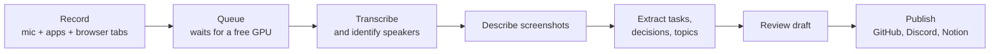

# Blah Blah Bot

Local meeting recorder for Windows that turns calls into GitHub issues and Discord summaries, using on-device speech and language models.

> **Project status:** design phase. The architecture and roadmap are complete; implementation starts with measured prototypes (Stage 0). Nothing described below is available as a release yet.

## What it will do

- **Record only what matters.** Microphone and selected applications are captured as separate tracks, so music and notifications stay out of the recording.
- **Process after the call.** Transcription, speaker recognition and summarization run locally once the meeting is over and the GPU is free. Nothing runs while you talk.
- **Know who said what.** Name a voice once from a short clip; it is recognized in later meetings of the same project.
- **Keep the team in sync.** Reports are committed to a Git repository, tasks become GitHub issues with owners and due dates, and a short summary goes to Discord.
- **Remember the context.** Each meeting series carries its open tasks, open topics, glossary and participants into the next meeting, starting with a briefing.
- **Show its sources.** Every task and decision links to the quote and timestamp it came from.

## How it works

A Tauri and Rust application handles recording, the job queue and publishing. Model inference runs in a Python process that exists only while a meeting is being processed. See [docs/ARCHITECTURE.md](docs/ARCHITECTURE.md).

## Roadmap

| Stage | Scope | Release | Status |
|---|---|---|---|
| 0 | Prototypes and decision gate | v0.1.0 | Next |
| 1 | Recorder | v0.2.0 | Planned |
| 2 | Processing pipeline | v0.3.0 | Planned |
| 3 | Speakers and voice profiles | v0.4.0 | Planned |
| 4 | Cycles and reports | v0.5.0 | Planned |
| 5 | Publishing | v0.6.0 | Planned |
| 6 | Convenience | v0.7.0 | Planned |
| 7 | Integrations | v0.8.0 | Planned |
| 8 | Stabilization | v1.0.0 | Planned |

Details are in [docs/ROADMAP.md](docs/ROADMAP.md).

## Documentation

- [Architecture](docs/ARCHITECTURE.md)
- [Roadmap](docs/ROADMAP.md)
- [Testing strategy](docs/TESTING.md)
- [Risks and prototypes](docs/RISKS-AND-POC.md)
- [Architecture decision records](docs/decisions/README.md)

## License

Released under the [MIT License](LICENSE).

## Author

Radosław Wójcik
