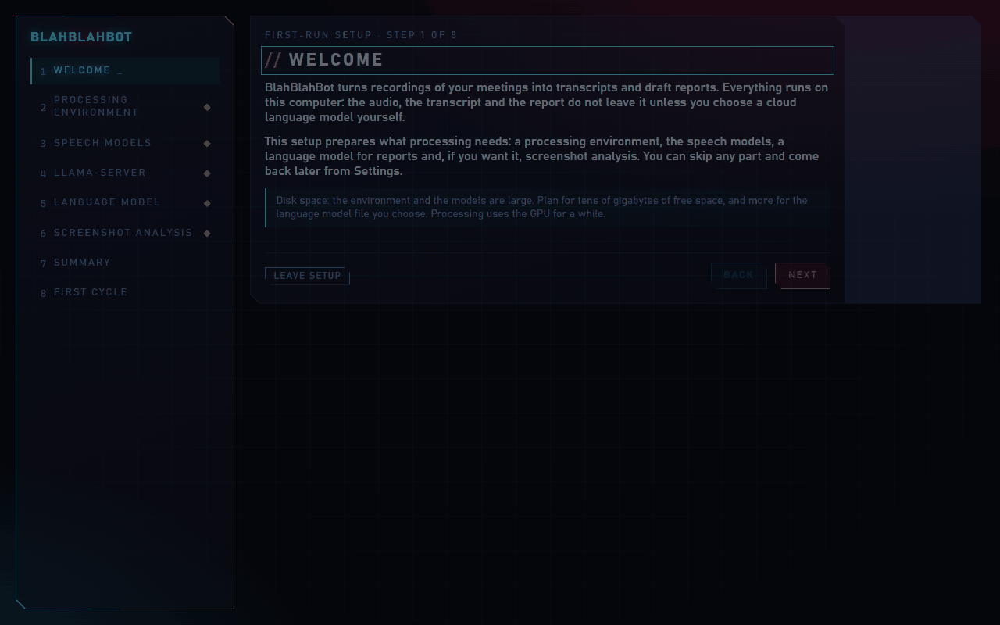
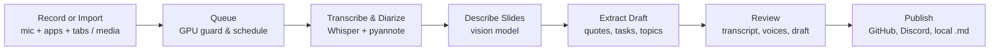
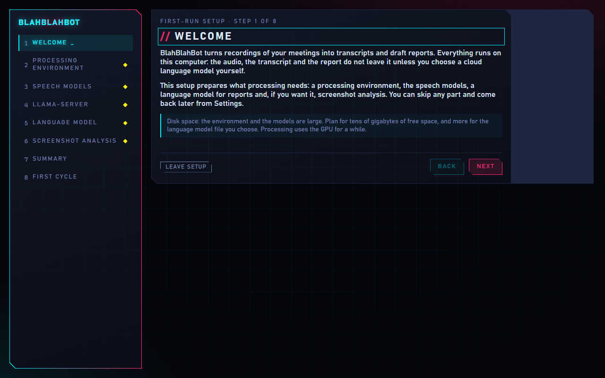
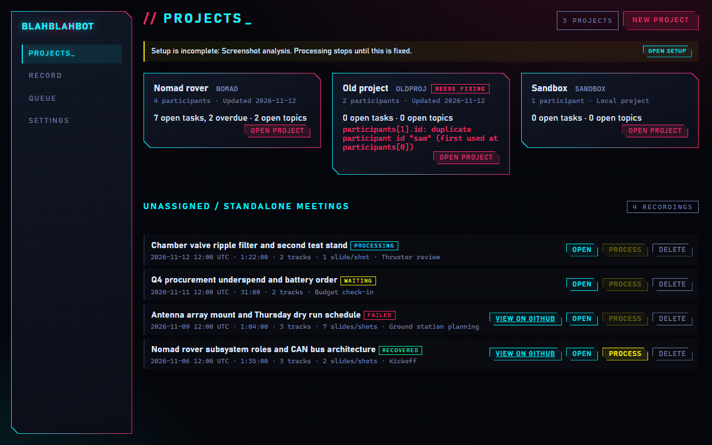
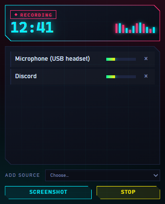
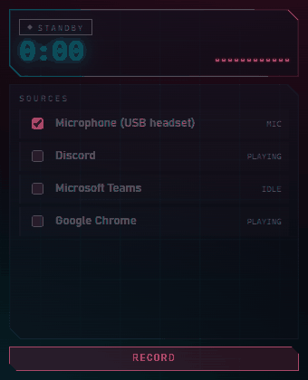
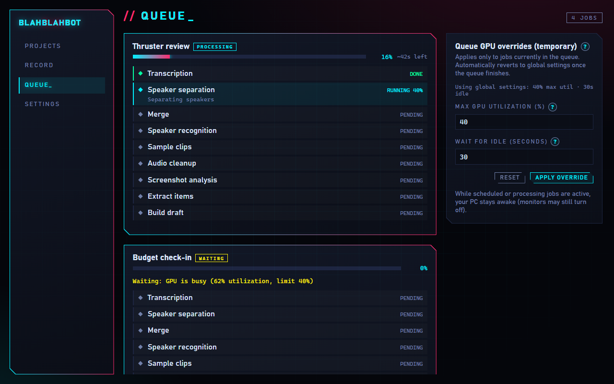
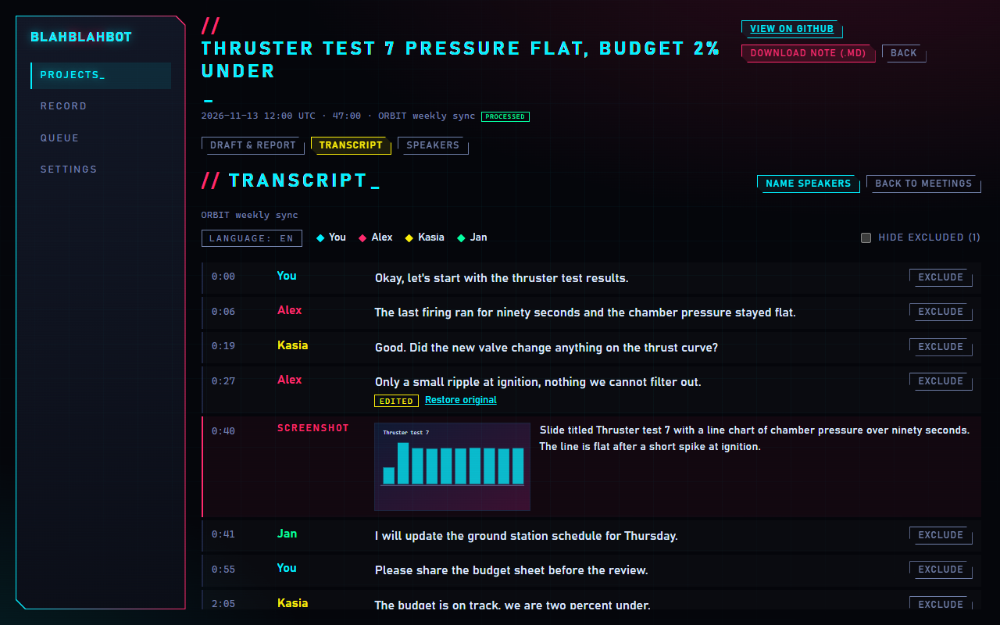
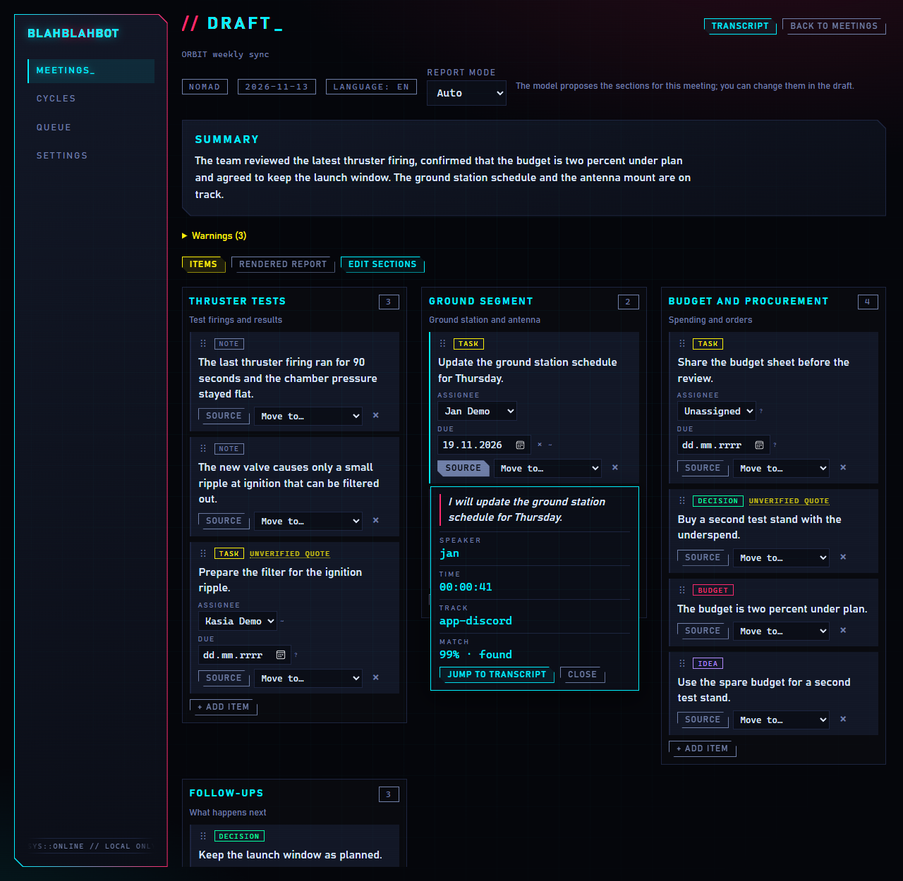
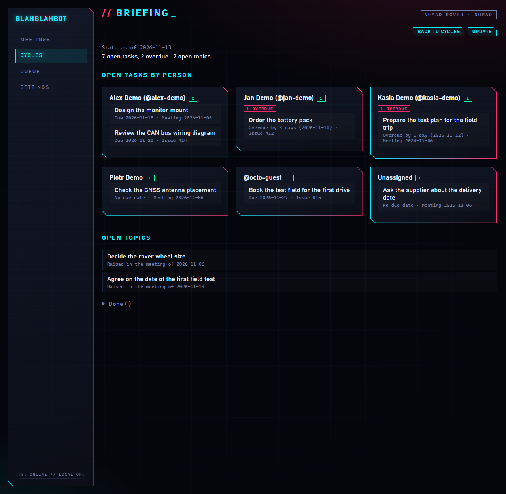

# Blah Blah Bot

Local meeting recorder and notes assistant for Windows that turns calls and recordings into structured drafts, GitHub issues, Discord summaries, and local Markdown notes using on-device speech and language models.


> **Project status:** Built on Stage 6 (`v0.7.0`) with the 12-point UX overhaul and Stage 8 first-run setup and installer prep. Verified on Windows 10 (build 19045; Windows 11 is untested). GitHub publishing and Discord webhooks were run once against a real test repository and webhook and otherwise tested against fake servers and local Git clones; browser tab capture, call detection, and extraction benchmarks rest on synthetic recordings, scripted traces, and mock E2E suites (see [Limitations](docs/LIMITATIONS.md) and [Installing on Windows](docs/INSTALL.md)).



## What it does

- **Projects workspace:** Organize recurring meeting series under `Projects` with a 2-step `ProjectWizard`, live briefings of open tasks and discussion topics, Git-backed project repositories, and optional local Markdown auto-save.
- **Record or import media:** Record from the Main UI `Record` tab (with live 12-bar `WaveformEq`) or the tray widget using Windows process loopback (`AudioSrv`-filtered app sessions, microphone, Chrome tab extension), take global region screenshots (`Ctrl+Alt+Shift+F10`), or import audio/video files with automatic slide detection (`+ Add meeting`).
- **Crash-safe capture:** Audio writes in 60-second WAV segments beside an append-only journal; interrupted recordings recover at the next launch with at most the in-progress segment lost. A `SystemWakeLock` keeps the PC awake during recording and scheduled/active processing.
- **Smart processing queue:** Staged local pipeline (Whisper `large-v3-turbo`, pyannote speaker diarization, Qwen3-VL vision, Gemma 4 extraction) that waits when the GPU is busy, supports temporary queue GPU overrides, scheduled start times, `Force process`, and crash resume.
- **Speakers & voice profiles:** Play short sample clips for detected voices, assign or merge participants, confirm automatic matches, and enroll voices manually from 15–30 s audio/video samples under `Settings > Voice Profiles`.
- **Transcript & draft editing:** Correct or exclude transcript segments (edits survive re-processing), inspect verified source quotes and uncertainty flags, switch report modes (`fixed`, `template`, `auto`, `by-type`), review AI-proposed status changes, and export standalone `.md` notes locally.
- **GitHub & Discord publishing:** Commit reports and transcripts to the project Git repository, create and close GitHub issues with assignees and due dates, post Discord webhook summaries with mentions and screenshots, and retry offline via a persistent outbox.
- **5-tab Settings & First-Run Wizard:** Guided first-run setup checks `uv`, speech/vision models, `llama-server`, and GGUF files; tabbed `Settings` covers `AI Models` (with disk auto-detection), `Connectors`, `Preferences`, `Processing`, and `Voice Profiles`.
- **Private & offline after setup:** Managed `llama-server` or external OpenAI-compatible LAN servers run locally; per-meeting cloud inference requires explicit confirmation. Tokens and API keys stay in the Windows Credential Manager.

## How it works



A Tauri + Rust desktop application manages audio capture, the SQLite store, the job queue, and publishing; Python workers run one stage at a time via `uv` so models never compete for VRAM. See [docs/ARCHITECTURE.md](docs/ARCHITECTURE.md).

### Report modes & LLM backends

| Mode / Backend | Behavior |
|---|---|
| `fixed` | Built-in sections: summary, decisions, tasks, open topics, notes, ideas, budgets |
| `template` | Sections declared in a project Markdown template |
| `auto` | Sections proposed by the model from extracted items (editable in the draft) |
| `by-type` | Template mapped from the meeting type chosen before recording |
| `managed` (default) | Local `llama-server` with a `.gguf` model (`16384` context by default) |
| `external` | Any local/LAN OpenAI-compatible server; API keys never sent over plain `http` to remote hosts |
| `cloud` | Per-meeting opt-in only, never a default or fallback; shows endpoint host and byte count before confirming |

## Security & privacy

- **Secrets stay in Credential Manager:** GitHub tokens, Hugging Face tokens, Discord webhooks, and LLM API keys are stored write-only in the Windows Credential Manager and never written to settings files or logs.
- **Hardened shell & path validation:** Strict Tauri CSP, local-drive path checks (UNC/network paths refused), and explicit confirmation before publishing to public repositories.
- **Biometric voice data:** Voice embeddings and sample clips stay local; sample clips are swept after speaker confirmation or `clipMaxDays` (default 30 days) and can be deleted per participant or globally.

## Quick start

### Requirements

| Component | Verified baseline |
|---|---|
| OS | Windows 10 version 2004+ (verified on build 19045; Windows 11 untested) |
| GPU | NVIDIA with 12 GB VRAM (reference: RTX 3080; peak 9.7 GB absolute in 10 h extraction) |
| Build & runtime | Rust 1.85+, Node.js 22+, `git` on `PATH`, [uv](https://docs.astral.sh/uv/) on `PATH` (~7.4 GB Python env) |
| Browser tabs | Chrome 116+ (tested on Chrome 136) with the unpacked extension |
| Disk | ~115 MB per track per recorded hour + local GGUF models |

### Install or build from source

- **Windows installer:** Download `Blah-Blah-Bot_<version>_x64-setup.exe` and `SHA256SUMS.txt` from Releases, verify the SHA-256 checksum, and run the per-user NSIS installer. See [docs/INSTALL.md](docs/INSTALL.md) for SmartScreen guidance and build instructions.
- **Run from source:**

```bash
cd ui && npm ci && npm run build && cd ..
cargo run -p app --release --features custom-protocol
```

On first launch, the setup wizard guides you through preparing the Python environment, storing a Hugging Face token (for gated speaker diarization weights), locating `llama-server`, and picking local `.gguf` models. Full setup instructions for Projects, Queue controls, 5-tab Settings, GitHub/Discord credentials, and the Chrome extension live in [docs/USER-GUIDE.md](docs/USER-GUIDE.md) and [docs/guides/extension.md](docs/guides/extension.md).

### Demo mode & test suites

Run the UI on generated demo data without audio hardware by setting `BBB_DEMO=1` (or open the Vite dev server in mock mode). Verify the codebase locally with:

```bash
cargo test --workspace
cd ui && npm test && npx playwright test --project=mock
```

See [docs/TESTING.md](docs/TESTING.md) for the real-application E2E suite and GPU preflight checks.

## Key views

Screenshots captured from demo mode (`BBB_DEMO`) with fictional data and mock GitHub/Discord servers:

| | |
|---|---|
|  |  |
|  |  |
|  |  |
|  |  |
|  |  |
|  |  |
|  |  |

## Measured benchmarks

Measurements were collected on the reference machine (RTX 3080 12 GB, Windows 10 build 19045) using synthetic recordings and scripted traces unless noted. Raw JSON results live in [benchmarks/results](benchmarks/results).

| Stage / Benchmark | Measured result | Target / Note |
|---|---|---|
| Stage 1 · 10 h recording soak (`stage1-soak-10h.json`) | 0.017% CPU, 10.1 MB peak RAM, 0 app track drops | Target <=3% CPU, <=200 MB; mic logged 194 continuity flags (audio continuous) |
| Stage 2 · 2 h pipeline (`stage2-pipeline-2h.json`) | 6.1 min total (ASR 234 s, diarize 106 s, vision 22 s), 8.5 GB VRAM | Target <=45 min, <=11.5 GB VRAM; VRAM returned to idle after every stage |
| Stage 3 · Speaker recognition (`stage3-speaker-recognition.json`) | 100% of 3,302 s enrolled speech named; 0/16 false accepts | Target >=90% recall, <=2% false accepts (clean synthetic voices) |
| Stage 4 · Extraction, Gemma 4 12B Q4 (`stage4-extraction-*.json`) | 100% schema & quote validity; 86.0% task recall, 89.3% precision, 92.8% assignee, 92.2% due date; 8,867 MiB VRAM above baseline | Met all targets (Qwen3 14B missed recall, assignee, and due date on the same 10 meetings) |
| Stage 4 · 10 h transcript extraction (`stage4-long-gemma-4-12b-q4.json`) | 51.4 min (43 windows), 9,743 MiB absolute VRAM, 1,431 valid items | Combined 10 h ASR + diarize + extract estimate ~86 min (target <=4 h) |
| Stage 6 · Tab stream & detection (`stage6-tab-30min-synthetic.json`, `stage6-detection-balanced.json`) | 5,978 frames over 120 s (0 lost, 46.3 ms max gap); 6/6 synthetic calls prompted, 0 false prompts on 4 min real idle trace | Reduced 2 min continuity run (`full_run: false`); 30 min real tab, real calls, and 8 h day unverified |

## Documentation

- [User guide](docs/USER-GUIDE.md) — projects, recording, media import, queue controls, 5-tab settings, voice enrollment, GitHub/Discord publishing
- [Installing on Windows](docs/INSTALL.md) — NSIS installer payload, SHA-256 verification, SmartScreen, clean-machine checklist
- [Browser extension guide](docs/guides/extension.md) — unpacked Chrome installation, pairing, and tab capture
- [Projects & templates](docs/CYCLES.md) — `cycle.yaml`, glossary, report modes, and Markdown template placeholders
- [Architecture](docs/ARCHITECTURE.md) — crate structure, IPC boundary, worker lifecycle, and security model
- [Testing](docs/TESTING.md) & [Requirements traceability](docs/TRACEABILITY.md) — test suites, 52 requirements, and known gaps (G1–G13)
- [Limitations](docs/LIMITATIONS.md) & [Troubleshooting](docs/TROUBLESHOOTING.md) — honest scope boundaries and error recovery
- [Roadmap](docs/ROADMAP.md) & [Decision records](docs/decisions/README.md) — release history and ADRs

## License & Author

Released under the [MIT License](LICENSE) by Radosław Wójcik.
