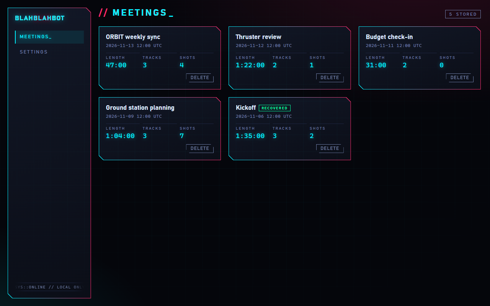
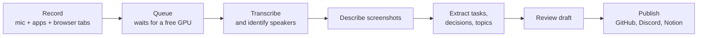

# Blah Blah Bot

Local meeting recorder for Windows that turns calls into GitHub issues and Discord summaries, using on-device speech and language models.


> **Project status:** Stage 1 (the recorder) is complete, with one measured exception described below. The application records the microphone and chosen applications and keeps a local meeting list. It does not process recordings yet: transcription, speaker recognition and reports come in the next stages. There is no installer; build from source.

## What works today

- **Tray recorder.** A widget in the tray starts and stops recording. Sources are the microphone and any application that has an audio session; each is stored as its own track.
- **Change sources while recording.** Add or remove a source at any time; a source added later is aligned on the same session clock.
- **Crash-safe storage.** Audio is written in 60 second segments next to an append-only journal. A killed or crashed recording is found again at the next start and can be recovered; at most the segment being written is lost.
- **Region screenshots.** A global hotkey freezes the desktop (all monitors), you drag a rectangle, and the crop is saved with its offset in the recording.
- **Meeting list and settings.** Local list of recordings with their tracks and screenshots; folders and hotkeys are configurable.
- **Demo mode.** The interface runs on fictional data without any audio device, which is how the screenshots below are produced.

## Screenshots

Taken from demo mode with fictional data.

| | |
|---|---|
|  |  |
|  |  |

## Requirements and getting started

| | |
|---|---|
| OS | Windows 10 version 2004 or newer (verified on build 19045); Windows 11 not tested yet |
| Build tools | Rust 1.85 or newer, Node.js 22 or newer |
| Disk | about 115 MB per track per recorded hour |

```bash
cd ui && npm ci && npm run build && cd ..
cargo run -p app --release --features custom-protocol
```

Recordings are written to `Documents\BlahBlahBot\recordings` unless you change the folder in the settings. Run the tests with `cargo test --workspace`, `npm test` and `npx playwright test --project=mock` in `ui`; the end-to-end suite against the real application is `npx playwright test --project=real` after a debug build.

## Stage 1 measurements

A 10 hour recording of the default USB microphone and two test processes on the reference machine (Windows 10 build 19045), taken while the computer was in normal use. Raw data: [benchmarks/results/stage1-soak-10h.json](benchmarks/results/stage1-soak-10h.json); details in [ADR 0002](docs/decisions/0002-audio-capture.md).

| Measure | Result | Target |
|---|---|---|
| CPU, three tracks | 0.017% of total CPU | 3% or less |
| Memory | 10.1 MB peak | 200 MB or less |
| Lost buffers, application tracks | 0 | 0 |
| Lost buffers, microphone | 194 flags from the audio engine, about one every 3 minutes; the audio is continuous and its length is exact | 0 (not met) |
| Continuity | 601 complete segments per track, no gaps in the journal | no gaps |
| Process killed during recording | at most the segment being written is lost | 60 s or less |

The microphone flags were not explained: no second microphone was tried and nothing was found missing in the audio. Windows 11, real Teams and Discord calls and multi-monitor setups with different scaling are not tested yet.

## What it will do

- **Record only what matters.** Microphone and selected applications are captured as separate tracks, so music and notifications stay out of the recording.
- **Process after the call.** Transcription, speaker recognition and summarization run locally once the meeting is over and the GPU is free. Nothing runs while you talk.
- **Know who said what.** Name a voice once from a short clip; it is recognized in later meetings of the same project.
- **Keep the team in sync.** Reports are committed to a Git repository, tasks become GitHub issues with owners and due dates, and a short summary goes to Discord.
- **Remember the context.** Each meeting series carries its open tasks, open topics, glossary and participants into the next meeting, starting with a briefing.
- **Show its sources.** Every task and decision links to the quote and timestamp it came from.

## How it works



A Tauri and Rust application handles recording, the job queue and publishing. Model inference runs in a Python process that exists only while a meeting is being processed. See [docs/ARCHITECTURE.md](docs/ARCHITECTURE.md).

## Stage 0 measurements

Prototype results on the reference machine (RTX 3080 with 12 GB, Windows 10 build 19045). Test meetings are synthetic: scripted text, voices cloned from English reference voices (Polish speech therefore carries an English accent). Treat the numbers as a comparison between candidates, not as a promise for real meetings. Raw data is in [benchmarks/results](benchmarks/results); the reasoning is in the [decision records](docs/decisions/README.md).

| Area | Result | Target |
|---|---|---|
| Recording (Windows process loopback) | 0 dropped buffers in 2 h; tracks isolated to -63 dB; alignment error 27 ms; 0.03% CPU; 10 MB memory | 0 drops; -40 dB; 50 ms; 3%; 200 MB |
| Speech recognition, Whisper turbo | WER 8.9% Polish, 14.3% English, 16.4% mixed; 36 times faster than real time | 15%, 20% for mixed; 10 h in 60 min |
| Speech recognition, Whisper large-v3 | WER 11.5% Polish, 29.6% mixed; 7 times faster than real time | as above |
| Term recall of English terms, best configuration | 51% | 85% (not met) |
| Diarization, 2 to 4 speakers | DER 20.5 to 23.3% against a speech-only reference | 15% (not met) |
| Diarization, 8 speakers | DER 23.4% | 30% |
| Speaker recognition, 4 enrolled voices | 100% accuracy, unknown voice rejected | 90% |
| Task extraction, Gemma 4 12B | recall 89%, precision 95%, assignee 91%, due date 88%, all quotes verified | 80%, 80%, 85%, 85% |
| Slide description, Qwen3-VL 8B | 100% of key facts, 1.5 s per image | not set |
| 10 hours of audio, all stages | about 58 minutes (extraction extrapolated) | 4 hours |
| Browser tab capture | idle machine: no lost frames, longest gap 47 ms in 31 minutes; with the machine in use: gaps of 218 to 667 ms | gaps of 100 ms or less (met only when idle) |
| Python environment from lock file | 70 s and 7.4 GB for speech and diarization groups | unattended |

## Roadmap

| Stage | Scope | Release | Status |
|---|---|---|---|
| 0 | Prototypes and decision gate | v0.1.0 | Done, gate passed |
| 1 | Recorder | v0.2.0 | Done; microphone buffer flags in the 10 hour run are open |
| 2 | Processing pipeline | v0.3.0 | Planned |
| 3 | Speakers and voice profiles | v0.4.0 | Planned |
| 4 | Cycles and reports | v0.5.0 | Planned |
| 5 | Publishing | v0.6.0 | Planned |
| 6 | Convenience | v0.7.0 | Planned |
| 7 | Integrations | v0.8.0 | Planned |
| 8 | Stabilization | v1.0.0 | Planned |

Details are in [docs/ROADMAP.md](docs/ROADMAP.md).

## Documentation

- [Architecture](docs/ARCHITECTURE.md)
- [Roadmap](docs/ROADMAP.md)
- [Testing strategy](docs/TESTING.md)
- [Risks and prototypes](docs/RISKS-AND-POC.md)
- [Architecture decision records](docs/decisions/README.md)

## License

Released under the [MIT License](LICENSE).

## Author

Radosław Wójcik
