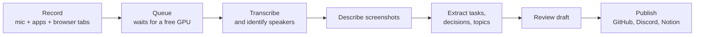

# Blah Blah Bot

Local meeting recorder for Windows that turns calls into GitHub issues and Discord summaries, using on-device speech and language models.

> **Project status:** Stage 0 is complete. The architecture and roadmap are done, the prototypes have been measured (see below) and the decision gate fixed the model choices. Several requirements are not yet met on synthetic data and are re-checked on real recordings in Stage 1. There is no application to install yet.

## What it will do

- **Record only what matters.** Microphone and selected applications are captured as separate tracks, so music and notifications stay out of the recording.
- **Process after the call.** Transcription, speaker recognition and summarization run locally once the meeting is over and the GPU is free. Nothing runs while you talk.
- **Know who said what.** Name a voice once from a short clip; it is recognized in later meetings of the same project.
- **Keep the team in sync.** Reports are committed to a Git repository, tasks become GitHub issues with owners and due dates, and a short summary goes to Discord.
- **Remember the context.** Each meeting series carries its open tasks, open topics, glossary and participants into the next meeting, starting with a briefing.
- **Show its sources.** Every task and decision links to the quote and timestamp it came from.

## How it works

A Tauri and Rust application handles recording, the job queue and publishing. Model inference runs in a Python process that exists only while a meeting is being processed. See [docs/ARCHITECTURE.md](docs/ARCHITECTURE.md).

## Stage 0 measurements

Prototype results on the reference machine (RTX 3080 with 12 GB, Windows 10 build 19045). Test meetings are synthetic: scripted text, voices cloned from English reference voices (Polish speech therefore carries an English accent). Treat the numbers as a comparison between candidates, not as a promise for real meetings. Raw data is in [benchmarks/results](benchmarks/results); the reasoning is in the [decision records](docs/decisions/README.md).

| Area | Result | Target |
|---|---|---|
| Recording (Windows process loopback) | 0 dropped buffers in 2 h; tracks isolated to -63 dB; alignment error 27 ms; 0.03% CPU; 10 MB memory | 0 drops; -40 dB; 50 ms; 3%; 200 MB |
| Speech recognition, Whisper turbo | WER 8.9% Polish, 14.3% English, 16.4% mixed; 36 times faster than real time | 15%, 20% for mixed; 10 h in 60 min |
| Speech recognition, Whisper large-v3 | WER 11.5% Polish, 29.6% mixed; 7 times faster than real time | as above |
| Term recall of English terms, best configuration | 51% | 85% (not met) |
| Diarization, 2 to 4 speakers | DER 20.5 to 23.3% against a speech-only reference | 15% (not met) |
| Diarization, 8 speakers | DER 23.4% | 30% |
| Speaker recognition, 4 enrolled voices | 100% accuracy, unknown voice rejected | 90% |
| Task extraction, Gemma 4 12B | recall 89%, precision 95%, assignee 91%, due date 88%, all quotes verified | 80%, 80%, 85%, 85% |
| Slide description, Qwen3-VL 8B | 100% of key facts, 1.5 s per image | not set |
| 10 hours of audio, all stages | about 58 minutes (extraction extrapolated) | 4 hours |
| Browser tab capture | no lost frames in two 30-minute runs, but gaps of 218 to 667 ms | gaps of 100 ms or less (not met) |
| Python environment from lock file | 70 s and 7.4 GB for speech and diarization groups | unattended |

## Roadmap

| Stage | Scope | Release | Status |
|---|---|---|---|
| 0 | Prototypes and decision gate | v0.1.0 | Done, gate passed; open checks in the decision records |
| 1 | Recorder | v0.2.0 | Planned |
| 2 | Processing pipeline | v0.3.0 | Planned |
| 3 | Speakers and voice profiles | v0.4.0 | Planned |
| 4 | Cycles and reports | v0.5.0 | Planned |
| 5 | Publishing | v0.6.0 | Planned |
| 6 | Convenience | v0.7.0 | Planned |
| 7 | Integrations | v0.8.0 | Planned |
| 8 | Stabilization | v1.0.0 | Planned |

Details are in [docs/ROADMAP.md](docs/ROADMAP.md).

## Documentation

- [Architecture](docs/ARCHITECTURE.md)
- [Roadmap](docs/ROADMAP.md)
- [Testing strategy](docs/TESTING.md)
- [Risks and prototypes](docs/RISKS-AND-POC.md)
- [Architecture decision records](docs/decisions/README.md)

## License

Released under the [MIT License](LICENSE).

## Author

Radosław Wójcik
