# Blah Blah Bot

Local meeting recorder for Windows that turns calls into GitHub issues and Discord summaries, using on-device speech and language models.


> **Project status:** Stage 5 (publishing) is released as v0.6.0. The application keeps cycles in a Git repository and turns a processed transcript into an editable draft report with tasks, decisions, topics, notes, ideas and budgets, each linked to a quote. It commits the report to the cycle repository, creates GitHub issues, writes approved status changes back and posts to Discord through a webhook; it was run once against a real test repository and a real test webhook, and otherwise tested against fake servers and local Git repositories. Stage 1 still has one open measurement (microphone buffer flags, see below). There is no installer; build from source.

## What works today

- **Tray recorder.** A widget in the tray starts and stops recording. Sources are the microphone and any application that has an audio session; each is stored as its own track.
- **Change sources while recording.** Add or remove a source at any time; a source added later is aligned on the same session clock.
- **Crash-safe storage.** Audio is written in 60 second segments next to an append-only journal. A killed or crashed recording is found again at the next start and can be recovered; at most the segment being written is lost.
- **Region screenshots.** A global hotkey freezes the desktop (all monitors), you drag a rectangle, and the crop is saved with its offset in the recording.
- **Meeting list and settings.** Local list of recordings with their tracks and screenshots; folders and hotkeys are configurable.
- **Processing queue.** One job per meeting, split into stages (transcription, speaker separation, merge, audio cleanup, screenshot description). It starts when you say so, waits while another program is using the GPU and shows why, runs one model at a time, and continues from the stage it stopped in after a crash.
- **Transcript with speakers.** Whisper large-v3-turbo transcribes each track with word timestamps; pyannote separates the voices of application tracks; your microphone is you. Screenshots are described by a local vision model and placed in the transcript by time.
- **Name speakers once.** Each detected voice comes with a few short clips. Play them, pick a name or add a new participant, merge voices that are the same person, and confirm. Names appear in the transcript.
- **Known voices are recognized.** In the next meeting a voice that matches a profile is named automatically, a weaker match is only suggested, and an unknown voice stays unknown. Profiles learn only from labels you confirmed.
- **Voice privacy.** Voice profiles and sample clips are biometric data. They stay in the local database and recordings folder, sample clips are deleted once you have named the voices (or after 30 days), and you can delete one participant's voice or all voice data in the settings.
- **Review and edit.** Correct any passage or exclude it; excluded text is kept out of everything that leaves the transcript view. Edits survive a re-run.
- **Audio retention.** Full audio is deleted only after every stage that reads it succeeded, and deleting it after processing is the default. You can choose to keep it, or to keep it for a number of days.
- **Cycles.** A cycle is a recurring series of meetings with its own participants, glossary, report templates and defaults. Cycles live in a Git repository (cloned from an address, an existing folder, or a new local repository), so the team can read and change them without the application. The application shows the state of the last pull and keeps working offline.
- **Participants, glossary and templates.** Edited in the application and validated before saving; a broken cycle is listed with its problems instead of hiding the others. Voice profiles belong to a participant of a cycle.
- **Report mode gate.** Before a recording starts you choose the cycle, the report mode, a template or meeting type where the mode needs one, and the report language. A recording cannot start without a cycle and a mode.
- **Four report modes.** `fixed` (built-in sections), `template` (sections from a template of the cycle), `auto` (sections proposed from the extracted items) and `by-type` (a template chosen by meeting type). The mode can be changed after recording while the draft is not published.
- **Extraction with verified quotes.** After the screenshots are described, a language model extracts items per 15 minute window; every quote is matched against the transcript, and the time range comes from the matched text. Items are merged across windows and linked to the open topics and tasks of the cycle. Inferred values and unverified quotes carry a visible marker.
- **Draft editor.** Edit the text, assignee and due date of an item, add or delete items, rename, add and reorder sections, and move items between sections. Each item shows its source: the quote, the time and a jump to the transcript. A new draft never overwrites edits you made; you accept or discard it.
- **Output language.** `auto`, `pl` or `en` per cycle and per meeting; `auto` follows the dominant language of the transcript.
- **Language model backends.** A managed `llama-server` (default), an external OpenAI-compatible server, or a cloud endpoint chosen for one meeting only. The cloud is never a default and never a fallback: each meeting needs a confirmation that states the endpoint host and how much text will be sent.
- **Publish to the repository.** The report, the full transcript with time anchors, the meeting data and the screenshots are committed as new files under `meetings/<cycle>/<date>` and pushed. The commit is built without touching your working copy, a push that a colleague's commit made fail is built again on the new state, and `topics.yaml` is merged per topic.
- **Tasks as GitHub issues.** One issue per task with the label `cycle:<id>`, the assignee from the participant's GitHub login, the due date, a link to the report and to the passage of the transcript, and a hidden marker. A retry never creates a second issue. A due date goes into the organization's "Target date" field when it has one, otherwise into the body.
- **Status proposals.** When a meeting reports that an open issue or topic is finished, the draft proposes closing it, with the quote. Nothing is closed unless you approve it, and approved changes are written back as a close plus a comment. An issue closed on GitHub counts as done in the next briefing.
- **Discord summary.** A short message (always one, with a link to the full report) or your own template, with mentions of the participants' Discord users and roles and screenshots attached. Only the ids from `cycle.yaml` can notify anybody; `@everyone` and `@here` never do.
- **Rules per target and an outbox.** Each target publishes automatically, on your approval, or never. Operations that fail because there is no network, or because a service asks to wait, stay in a queue that survives a restart and are retried; a published meeting's draft becomes read-only.
- **Offline once set up.** Models are downloaded on first use with your Hugging Face token (kept in the Windows Credential Manager); processing itself needs no network.
- **Demo mode.** The interface runs on fictional data without any audio device, which is how the screenshots below are produced.

## Screenshots

Taken from demo mode with fictional data. The publishing images (the last five here and the token setup below) show the mock backend with fake GitHub and Discord servers: no real repository or channel was involved.

| | |
|---|---|
|  | 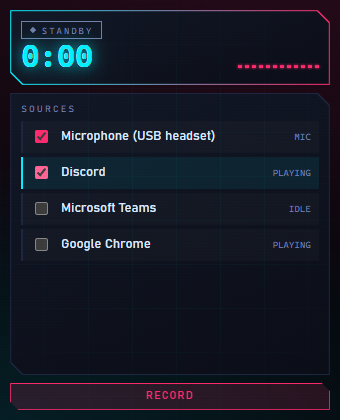 |
|  |  |
|  | 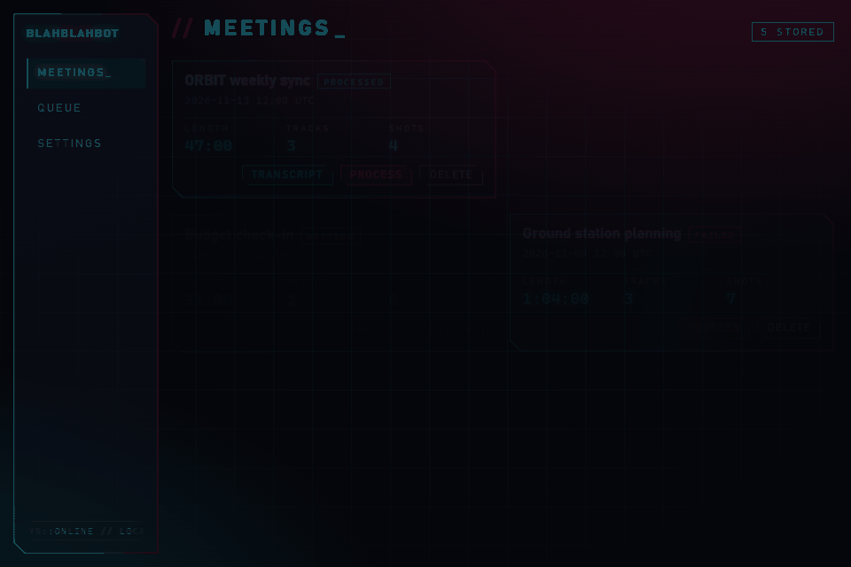 |
|  | 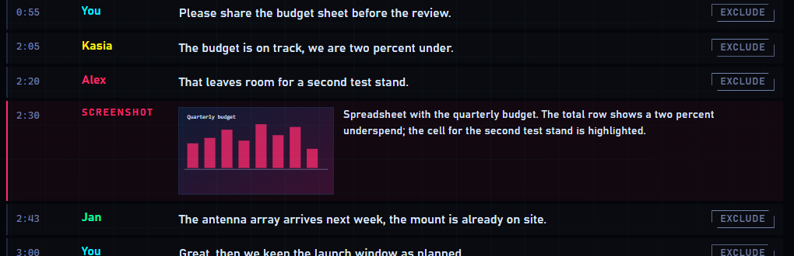 |
| 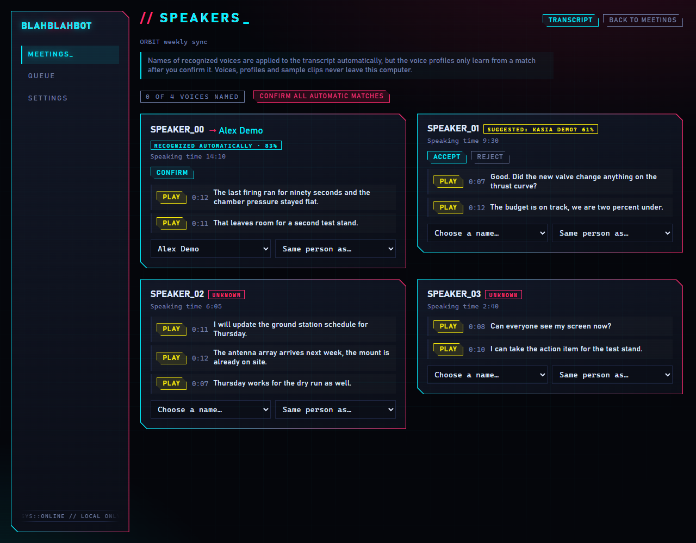 | 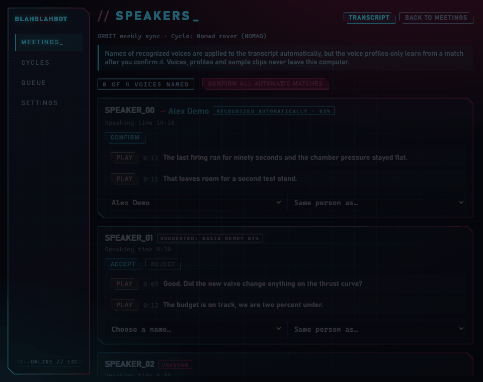 |
| 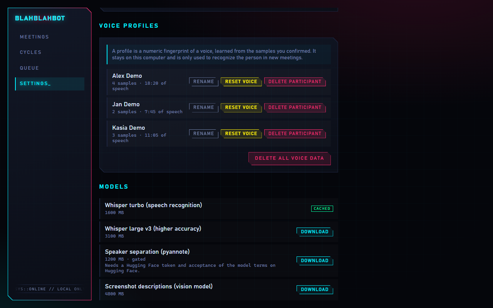 | 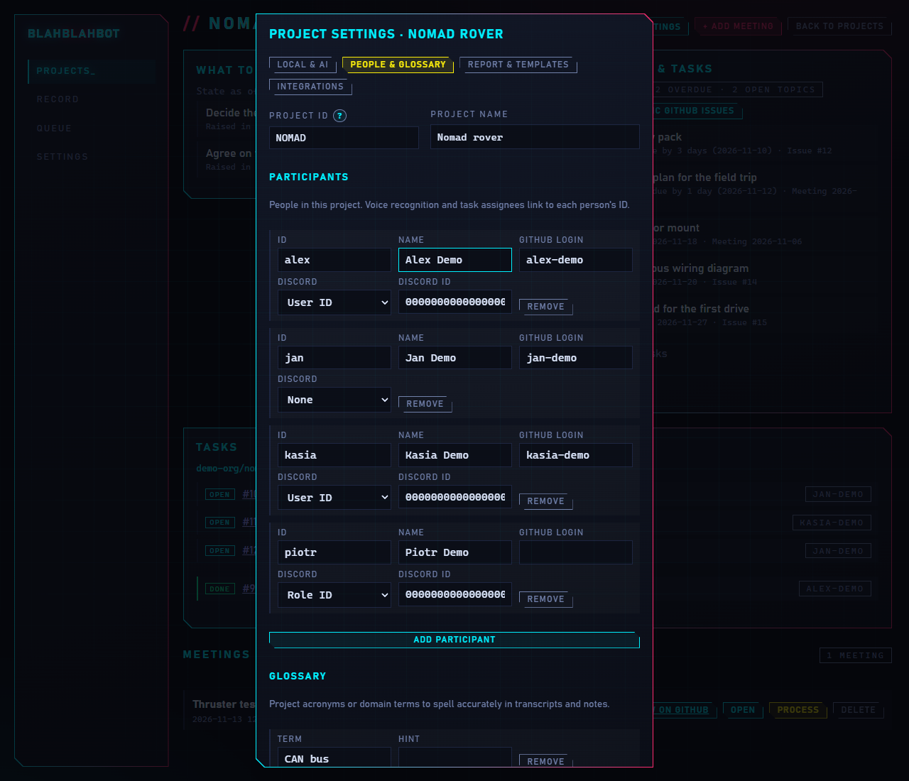 |
| 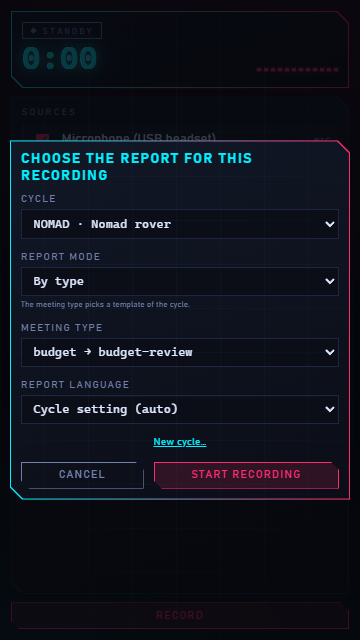 |  |
| 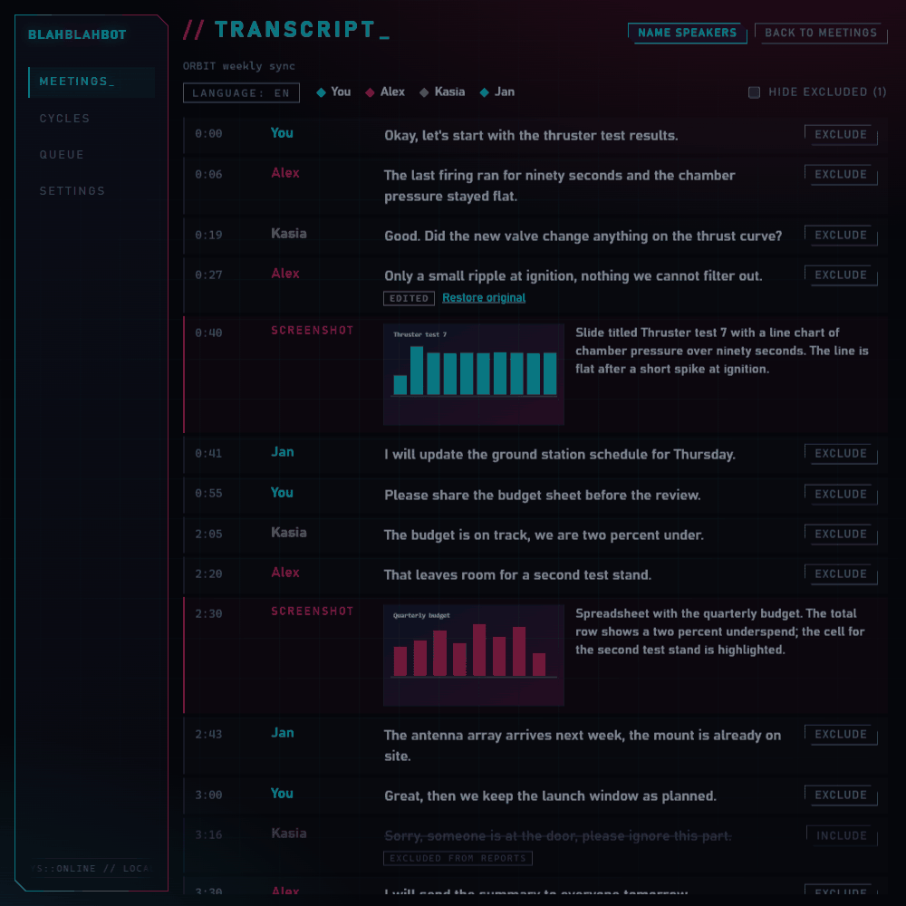 | 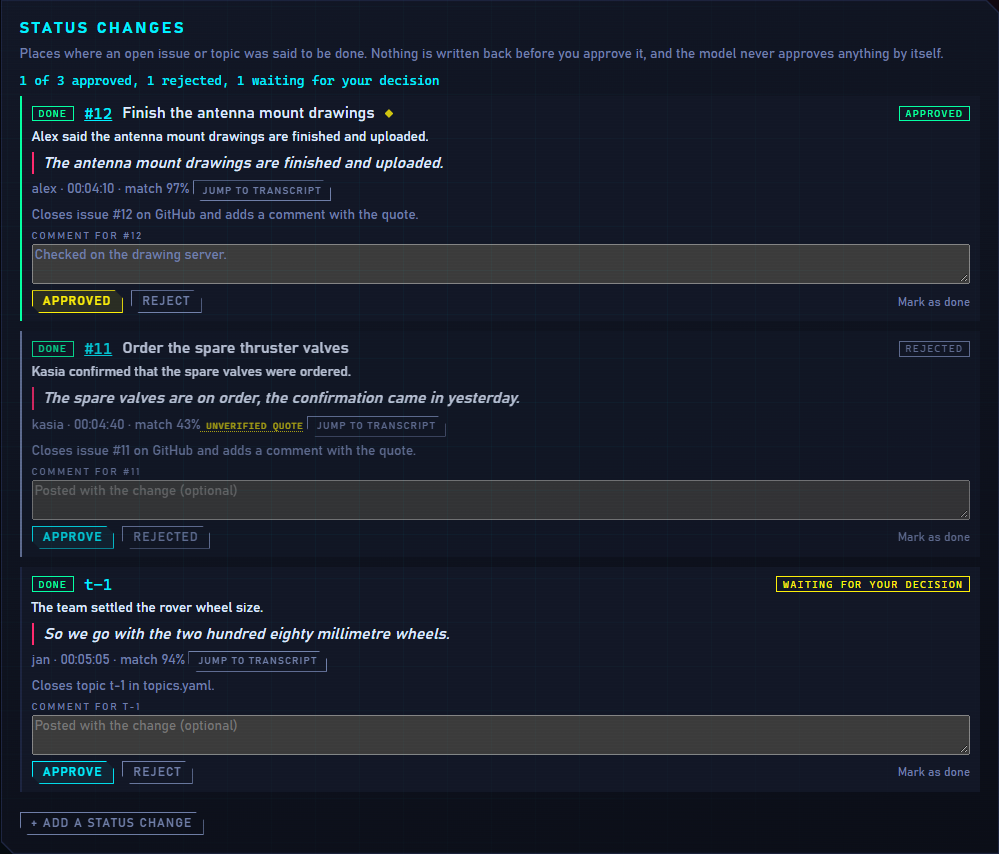 |
| 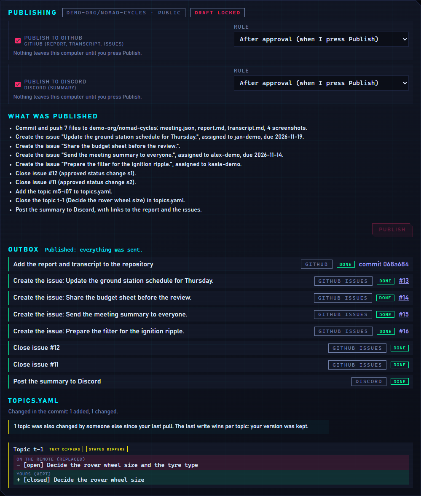 | 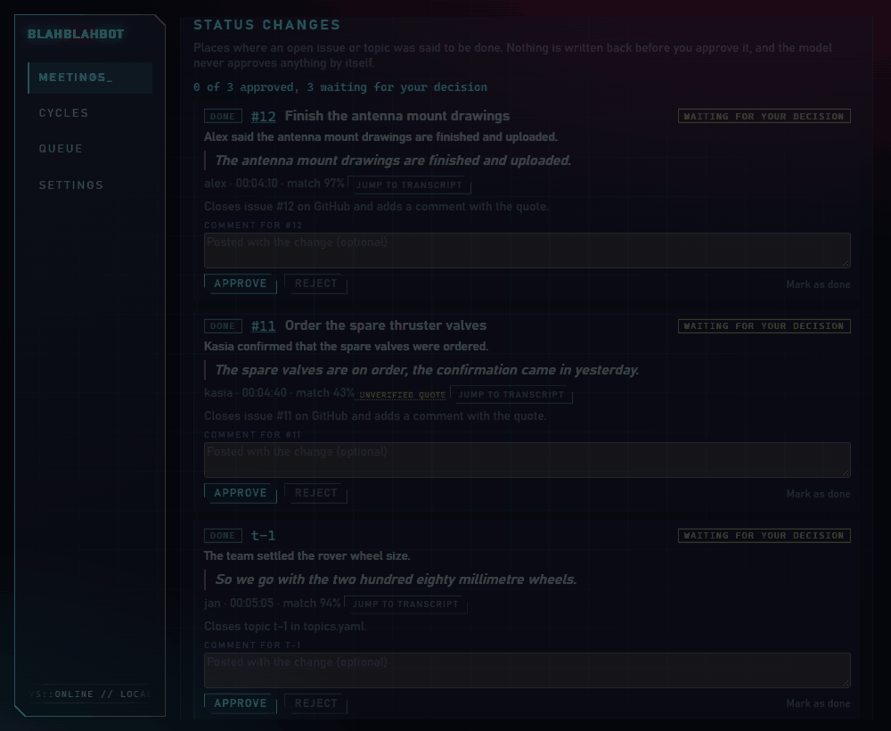 |
| 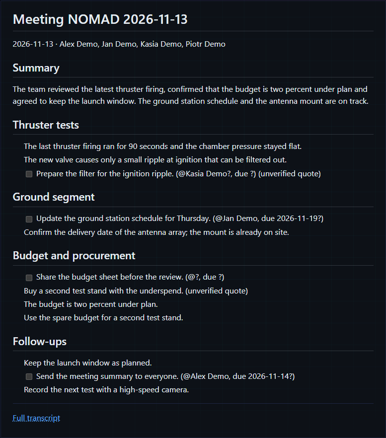 | 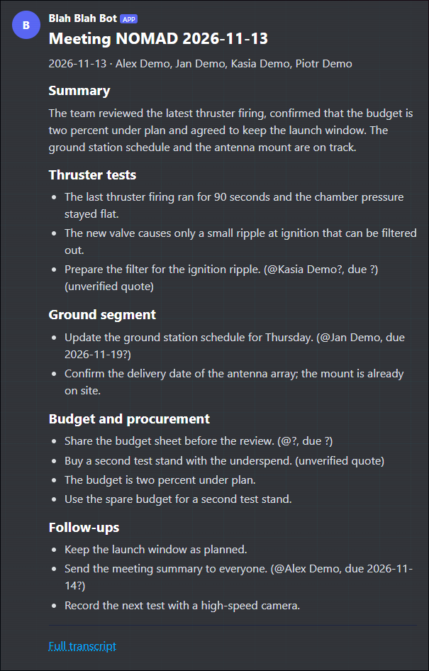 |

## Requirements and getting started

| | |
|---|---|
| OS | Windows 10 version 2004 or newer (verified on build 19045); Windows 11 not tested yet |
| Build tools | Rust 1.85 or newer, Node.js 22 or newer |
| GPU | NVIDIA with 12 GB VRAM (reference: RTX 3080); peak use measured at 8.5 GB in Stage 2 and 9.7 GB (absolute) during extraction of a 10 hour transcript |
| Cycle repositories | The `git` command line on the PATH (the application runs it for clone, pull and publishing; Git 2.31 or newer when a GitHub token is used for pushing); credentials come from the Git credential manager |
| Processing tools | [uv](https://docs.astral.sh/uv/) on the PATH; about 7.4 GB for the Python environment (created on first use); models downloaded on first use; a Hugging Face token and accepted terms for the speaker model |
| Disk | about 115 MB per track per recorded hour |

```bash
cd ui && npm ci && npm run build && cd ..
cargo run -p app --release --features custom-protocol
```

Open the settings to download the models and, for screenshot description and for extraction with the managed backend, to point the application to a `llama-server` executable, its model folder and a GGUF model file. Recordings are written to `Documents\BlahBlahBot\recordings` unless you change the folder in the settings. Run the tests with `cargo test --workspace`, `npm test` and `npx playwright test --project=mock` in `ui`; the end-to-end suite against the real application is `npx playwright test --project=real` after a debug build.

## Cycles and report modes

**Create a cycle.** Open the cycles screen, add a repository (clone it from an address, or point to an existing folder) or use the default local repository, enter a cycle id and a name, and create the cycle. The cycle gets `cycle.yaml`, an empty `topics.yaml` and a default template. Then edit its participants, glossary, report defaults and templates; the application validates the files before it writes them. A cycle repository is plain Markdown and YAML, so it can also be edited by hand. Changes made in the application are written to the working tree and are not committed by the application; publishing commits only the new meeting folder and `topics.yaml`, so commit edits of `cycle.yaml` and templates yourself.

| Mode | Sections | Chosen |
|---|---|---|
| `fixed` | Built-in: summary, decisions, tasks, open topics, notes, ideas, budgets | Cycle default |
| `template` | The `sections` declared by a template of the cycle; the model assigns each item to one | Cycle default or at the gate |
| `auto` | Proposed by the model from the extracted items; editable in the draft | At the gate |
| `by-type` | The template that `report.by_type` maps the meeting type to | Meeting type at the gate |

Templates are Markdown with placeholders. The common ones are `{title}`, `{date}`, `{participants}`, `{summary}`, `{sections}`, `{section:<id>}`, `{tasks}`, `{decisions}` and `{transcript_link}`; an unknown placeholder is an error, never silently dropped. The full list, the front matter and the file layout are in [docs/CYCLES.md](docs/CYCLES.md).

## Publishing setup

Publishing has been tested against fake GitHub and Discord servers and local Git repositories only. It has not yet been run against a real repository or channel; that check is the next step before the release, so treat the first real publication with care (use a private test repository and a test channel first). Everything below describes what the application does against those fakes; how real GitHub and Discord react is unverified.

**1. GitHub token (for issues, and for pushing over https).**

1. On GitHub, open Settings, Developer settings, Personal access tokens, Fine-grained tokens, and generate a token.
2. Resource owner: the user or organization that owns the cycle repository (an organization may have to approve the token). Repository access: only the cycle repository.
3. Repository permissions: **Contents: Read and write** (the commit and push), **Issues: Read and write** (create, close, comment, label, assign) and **Metadata: Read** (added automatically). Nothing else is needed.
4. In the application open **Settings** and scroll to **Publishing**. Under **GitHub token**, type the token into the masked field **GitHub token for api.github.com** and press **Store**; the card then reads **Token stored**. **Clear** removes it, and typing a new value replaces it. The token is stored in the Windows Credential Manager, bound to the GitHub API host it was entered for, and is never shown again, written to a file or logged. It is handed to Git through its environment, never on the command line.
5. Under **GitHub repository of a cycle repository**, each cycle repository has the fields **GitHub repository of `<id>`** (`owner/name`) and **API address of `<id>`**. Leave both empty when the address of the repository is on github.com: it is taken from there. Fill them for a GitHub Enterprise Server repository, a remote that is not on github.com, or to link a local repository, and press **Save link**. **Test access** checks the token, the repository, its visibility and the push permission.

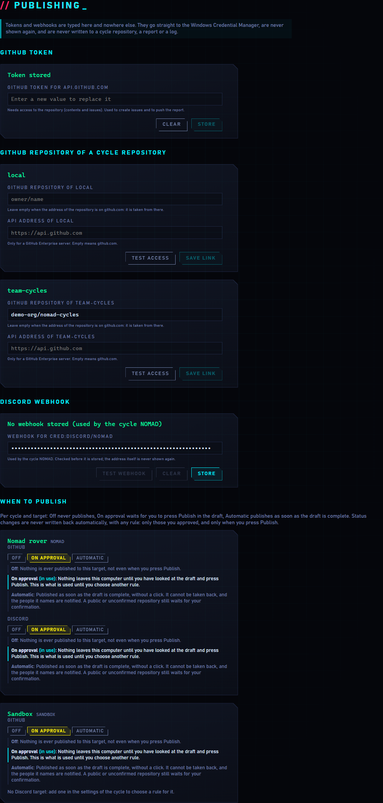

Without a token the application still pushes with the credentials of your Git credential manager, and reads the issues of a public repository anonymously; creating issues needs the token. A repository without a remote only gets a local commit.

The organization issue field "Target date" is used for due dates in organization repositories when it exists. That path has not been verified against a real organization; whenever it does not work, the due date is written as a `Due: YYYY-MM-DD` line in the issue body.

**2. Discord webhook.**

1. In Discord, open the channel settings, Integrations, Webhooks, create a webhook for the channel and copy its URL.
2. On the **Cycles** page press **Edit** on the cycle, and in the **Targets** section tick **Post a summary to a channel** under Discord. Give it a **Webhook reference**, never the URL, for example `cred:discord/nomad`. In `cycle.yaml` this is `discord: { webhook: cred:discord/nomad, publish: on-approval }`.
3. In **Settings**, **Publishing**, **Discord webhook**, paste the URL into **Webhook for cred:discord/nomad** and press **Store**; the card then reads **Webhook stored** with the address masked. Only `https://discord.com/api/webhooks/<id>/<token>` (and the `discordapp.com`, `canary.discord.com` and `ptb.discord.com` hosts) is accepted. **Test webhook** only checks that the webhook exists; it posts nothing.
4. To mention people, give the participants of the cycle a **Discord id** with its kind (user or role); in `cycle.yaml` that is `discord: { user_id: "123456789012345678" }` or `{ role_id: "..." }` in quotes (turn on Developer Mode in Discord and copy the id).

**3. Rules per target: you choose.** Each target of each cycle has a rule, chosen with a switch of three positions, and under the switch each position is explained by what it does to you:

| Rule | What it means |
|---|---|
| **Off** | Nothing is ever published to this target, not even when you press Publish. |
| **On approval** | Nothing leaves this computer until you have looked at the draft and press Publish. This is what is used until you choose another rule. |
| **Automatic** | Published as soon as the draft is complete, without a click. It cannot be taken back, and the people it names are notified. A public or unconfirmed repository still waits for your confirmation. |

The switch is in the **Targets** section of the cycle (when you tick **Commit reports to the repository** or **Post a summary to a channel** it shows **On approval**, and the cycle is saved with that unless you pick another), in the **Publishing** panel of a draft, and in **Settings**, **Publishing**, **When to publish**, for every cycle. In the panel and in Settings a change is saved to `cycle.yaml` at once and nothing else in the file changes. In `cycle.yaml` it is `targets.github.publish` and `targets.discord.publish` with `on-approval`, `auto` or `off`. Nothing is ever published automatically unless you set it so ([ADR 0019](docs/decisions/0019-default-publish-rule-per-target.md)). Status changes are never written back automatically, with any rule: only a decision you approved is, and only when you press Publish. Unticking **Create issues for tasks and write back approved status changes** (`targets.github.issues: false`) makes the GitHub target commit the report only.

**4. Approve status changes and publish.**

1. From the **Queue** press **Open draft** on a processed meeting. Edit the draft as usual; **Rendered report** shows the report, with a **Format** menu (GitHub Markdown or Chat for Discord and Notion) and a **Preview** toggle that renders it the way GitHub or Discord would.
2. In **Status changes** each place where an open issue or topic was said to be done comes with its quote and a jump to the transcript. Press **Approve** or **Reject**; the button then reads **Approved** or **Rejected**, and pressing it again takes the decision back. A comment is posted with the change. **+ Add a status change** adds one by hand for an issue or topic that the model did not find. Nothing is written back before you approve it.
3. In **Publishing**, tick **Publish to GitHub** and **Publish to Discord** as wanted. **What will happen** lists every operation: the files of the commit, each issue with its assignee and due date, each close and the Discord post. **topics.yaml: before and after** shows, per topic, what the remote has (as of the last time it was fetched) and what the commit will write, and marks a topic that a colleague changed since your last pull, which your version replaces; when the comparison is not possible the topics are only named, with a note. Press **Publish**.
4. If the repository is public, or its visibility cannot be read, the dialog **Publish to a public repository?** asks once; tick **I understand that `<repo>` is public and I want to publish to it** and press **Publish to a public repository**, or **Cancel** to publish nothing.
5. The **Outbox** shows each operation as **Waiting**, **Running**, **Done** or failed, with links to the commit and the issues. **Retry now** and **Cancel** act on one operation, **Retry all now** on all that wait. When everything is sent the list reads **What was published** and the draft is marked **Draft locked**. **topics.yaml** shows, per topic, what was changed and, when a colleague changed the same topic meanwhile, both versions: the last write wins and the other stays visible.

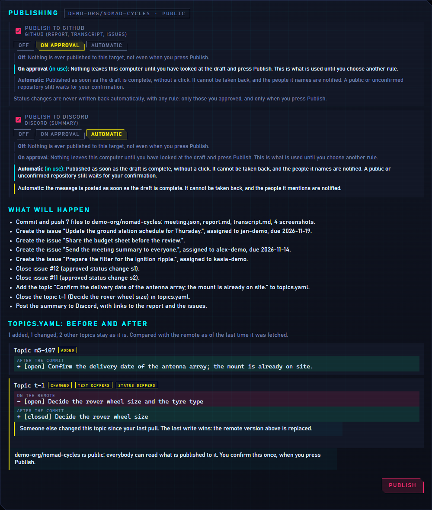

**5. Corrections after publishing.** Once a meeting is published, its draft is locked: what was published is what you approved. When something changes afterwards (a task is done, a date moves, a decision is reversed), open the draft and use **Corrections** under the **Publishing** panel:

1. Press **Add correction**, write **What changed**, optionally choose the item it is **About** and an **Issue** (`#12`), check the **Date** (today) and press **Add correction**. The note is kept with the meeting and already counts for the next meeting: its briefing and extraction are given it as current information, replacing what the earlier items say.
2. To publish it, press **Publish** next to it (or **Publish all**). It follows the rule of the GitHub target: with **Automatic** it is published when you add it, with **On approval** when you press Publish, with **Off** never. The public-repository confirmation applies as for the meeting.
3. Publishing adds a new file to the folder of the meeting in the repository, `corrections.md` and then `corrections-2.md`, and so on. Nothing that was published is changed. If the correction is about an item that became an issue (or names an issue) it is also posted as a comment on that issue, once. The row then reads **Published as corrections.md in the meeting folder, and commented on the issue**, with a link.
4. A correction that was queued is part of the record and cannot be edited or deleted. One that was never queued has **Delete**.

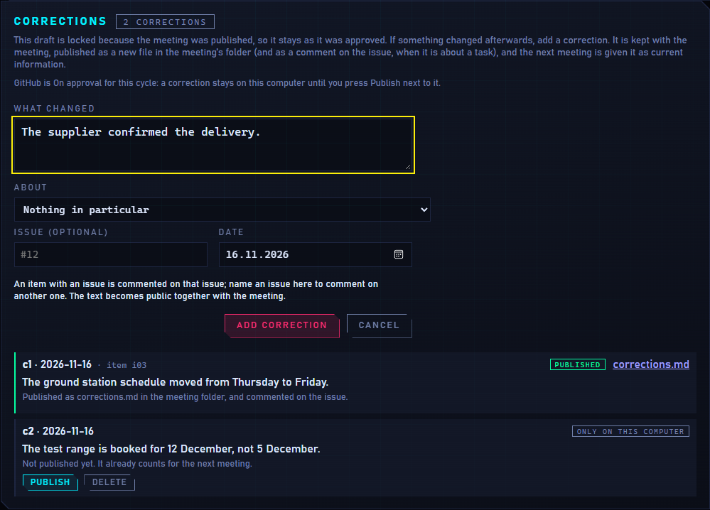

**6. Public repositories.** A transcript contains personal data and cannot be taken back from a Git history. If the repository is public, or its visibility cannot be read, nothing is published to it until you confirm that repository once, also under **Automatically**. The check is repeated right before anything is sent, so an operation queued earlier cannot slip into a repository that has since become public.

**7. Offline and retries.** Publishing never blocks on the network. Operations wait in a queue stored in the local database and are retried with a growing delay (or the delay a service asks for); a dead Discord does not hold back the report. Failures that need you (a wrong token, a missing permission, a repository that does not exist) stop with a message that contains no secret, and you retry or cancel them. Closing the application does not lose them. While operations of a meeting are queued, and after it is published, its draft cannot be edited. Publishing a meeting a second time is not supported; use a correction.

**Limits.** A Discord message holds 2000 characters: the built-in summary is cut to one message with the link to the full report on GitHub, a template of your own is split; screenshots go in separate messages of at most 10 files and 8 MiB (a conservative choice), at most three of them, and the rest is left to the report. A pushed commit, an issue assignment and a Discord mention cannot be recalled by the application. The meeting goes to `<folder>/<cycle>/<date>`, where the folder is the field **Folder for meeting reports** (`targets.github.path`, `meetings` by default).

## Configuration reference

**`cycles/<ID>/cycle.yaml`.** Only `id` and `name` are required; unknown keys are rejected.

| Key | Purpose |
|---|---|
| `languages.asr`, `languages.output` | `auto`, `pl` or `en` for transcription and for the report |
| `participants` | `id`, `name`, optional `github` login and `discord` user or role id |
| `glossary` | `term` with an optional `hint`, passed to the extraction prompt |
| `report.default_mode`, `report.default_template` | Mode and template offered before recording |
| `report.instruction` | A sentence given to the extraction, for example "Group tasks by person" |
| `report.by_type` | Meeting type to template name, for `by-type` mode |
| `targets.github`, `targets.discord` | Publishing targets and rules (`auto`, `on-approval` or `off`, default `on-approval`); `targets.github.issues: false` publishes the report only; secrets are only `cred:` references to the Windows Credential Manager |
| `targets.notion` | Accepted and validated; the Notion publisher arrives in a later stage |

Every key is described in [docs/CYCLES.md](docs/CYCLES.md); the schema is `schemas/cycle.schema.json`.

**Language model backends (application settings).**

| Setting | Meaning |
|---|---|
| Default backend | `managed` or `external`; the cloud cannot be the default |
| Managed | Path to a GGUF model file and the context size (default 16384 tokens); the worker starts and stops `llama-server` |
| External | Base URL and model name of an OpenAI-compatible server, and an optional key |
| Cloud | Base URL and model name of an OpenAI-compatible endpoint and a key; used for one meeting at a time after a confirmation |

Keys are stored in the Windows Credential Manager and are never shown again or written to a file.

**Environment switches** (development and tests): `BBB_DEMO` runs the interface on generated data without audio devices, `BBB_DATA_DIR` keeps all application data in one folder, `BBB_LOG` sets the log filter, `BBB_WORKER_DIR` points to the Python worker folder, `BBB_WORKER_ENV_DIR` to a shared worker Python environment (by default each data folder gets its own `worker-venv`).

## Stage 4 measurements

Ten synthetic meetings (4 Polish, 3 English, 3 mixed; five speakers, 15 minutes and about 2,100 words each) with planted tasks, decisions and budgets, run through the production `extract` and `reduce` steps with a managed `llama-server` (Q4_K_M, context 16384) on the reference machine (RTX 3080, Windows 10 build 19045). Raw data: `benchmarks/results/stage4-extraction-*.json`, `stage4-long-gemma-4-12b-q4.json` and `stage4-modes-*.json`.

| Measure | Gemma 4 12B | Qwen3 14B | Target |
|---|---|---|---|
| Schema validity | 100% (met) | 100% (met) | 100% |
| Task recall | 86.0% (met) | 71.7% (missed) | 80% or more |
| Task precision | 89.3% (met) | 94.1% (met) | 80% or more |
| Assignee accuracy | 92.8% (met) | 65.5% (missed) | 85% or more |
| Due-date accuracy | 92.2% (met) | 60.2% (missed) | 85% or more |
| Decision recall / precision | 49.9% / 90.5% | 40.4% / 77.8% | none |
| Budget recall / precision | 54.3% / 80.0% | 55.3% / 100% | none |
| Quote validity | 100% (met) | 99.4% (met) | 95% or more |
| Seconds per 1000 words (extract and reduce) | 41.3 | 46.3 | none |
| Peak VRAM above baseline | 8,867 MiB (met) | 11,129 MiB (met) | 11.5 GB or less (11,776 MiB) |

Gemma 4 12B meets every extraction threshold; Qwen3 14B misses task recall, assignee accuracy and due-date accuracy. Both models returned a valid schema on all ten meetings, and both stay below the VRAM limit.

**Per language.** English meetings are near 100% with Gemma 4 12B (task recall 100% on all three; Qwen3 14B 78.9% to 85.0%). Polish and mixed meetings are lower: per-meeting task recall is 43.5% to 100% for Gemma 4 12B and 43.5% to 86.4% for Qwen3 14B.

**Prompt change.** The first run used an earlier prompt and missed the task thresholds for both models (Gemma 4 12B: recall 58.6%, precision 60.8%, assignee 82.1%, due date 78.1%; Qwen3 14B: recall 58.4%, precision 73.7%, assignee 62.5%, due date 54.0%). The final prompt asks for the task text as an infinitive phrase and takes weekday dates from the calendar; its numbers are in the table. The initial runs are kept as `*-initial-prompt.json`.

**10 hours.** A transcript of 10 hours (83,548 words, 12,392 segments, the labeled meetings repeated 40 times) was processed by `extract` and `reduce` with Gemma 4 12B.

| Measure | Result | Target |
|---|---|---|
| Windows | 43, none skipped, 1 retried (45 attempts) | n/a |
| Wall time, extraction and reduce | 51.4 minutes (3,086 s: 3,066 s extraction, 21 s reduce) | n/a |
| Share of the 4 hour budget | 21.4% (with transcription and speaker separation, see below) | 4 hours or less in total |
| Peak VRAM above baseline | 9,217 MiB (9,743 MiB absolute) | 11.5 GB or less |
| Draft | valid, 1,431 items | n/a |

Transcription (22.5 minutes) and speaker separation (12.1 minutes) were measured in Stage 0 on a separate 10 hour file and were not repeated here, so the sum of about 86 minutes for the three stages is an estimate. Vision, publishing and model loading are not included. The transcript repeats synthetic meetings, so this run tests time and memory, not accuracy. The measured time was within 11% of the extrapolation from the per-meeting speed (41.3 s per 1000 words).

**Report modes.** On one meeting (`en-0`) all four modes (`fixed`, `template`, `auto`, `by-type`) produced a valid draft with every item placed in a section, with both models (Gemma 4 12B: 41 items; Qwen3 14B: 22 to 24 items).

**What these numbers do not show.**

- The meetings are synthetic and the task phrasing is simple and explicit; real meetings will be harder.
- In mixed meetings the model writes task text in the report language, so English tasks are translated; this lowers the text-based scores on those meetings.
- Decision and budget recall (about 50% for Gemma 4 12B) is not a target metric, but it is lower than task recall: part of the planted decisions and budget lines are not extracted.
- Tasks of different people can have equal text, which makes the text-based assignee and due-date accuracy pessimistic. The paired metrics in the JSON files are informative: for Gemma 4 12B assignee 99.5% and due date 98.4%, and recall and precision matched by assignee and due date alone 91.9% and 96.1% (Qwen3 14B: 96.1%, 90.9%, 68.3% and 89.2%). The thresholds are checked on the text-based scores.
- Quality on real recordings with recognition errors in the transcript is not measured.

## Stage 3 measurements

Seven synthetic meetings with 2 to 16 speakers, processed in order with the real models; after each meeting the true names were confirmed, which taught the profiles. Raw data: [benchmarks/results/stage3-speaker-recognition.json](benchmarks/results/stage3-speaker-recognition.json) and [benchmarks/results/p4-similarity-community-1.json](benchmarks/results/p4-similarity-community-1.json).

| Measure | Result | Target |
|---|---|---|
| Enrolled speech named correctly and automatically | 100% of 3302 s | 90% or more |
| New voices named automatically (false accepts) | 0 of 16 | 2% or less |
| Same voice, cosine similarity | 0.76 to 0.99 (0.68 to 0.99 after band limiting and noise) | n/a |
| Different voices, cosine similarity | up to 0.64 (up to 0.92 after band limiting and noise) | n/a |

The voices are synthesized and clean; real conference audio is not measured yet, and on band-limited, noisy audio some different voices come close to the same-voice range. Thresholds (0.75 automatic, 0.60 suggestion, 0.10 margin) are settings. See [ADR 0016](docs/decisions/0016-speaker-recognition.md).

## Stage 2 measurements

A synthetic recording of 2 hours (a repetition of short scripted meetings, one application track, 12 screenshots) processed stage by stage on the reference machine (RTX 3080, Windows 10 build 19045). It measures time and memory, not recognition quality. Raw data: [benchmarks/results/stage2-pipeline-2h.json](benchmarks/results/stage2-pipeline-2h.json).

| Stage | Time | Peak VRAM above baseline |
|---|---|---|
| Transcription | 234 s | 1.5 GB |
| Speaker separation | 106 s | 2.5 GB |
| Merge | 4 s | none |
| Screenshot description (12 images) | 22 s | 7.6 GB |
| **Total** | **6.1 minutes** (target 45 minutes or less) | **8.5 GB absolute** (target 11.5 GB or less) |

VRAM returned to the idle level after every stage. Tests with the real models on the short reference recordings cover the whole job, a worker killed in each stage and resumed, no network, and a job that waits while another process holds the GPU.

## Stage 1 measurements

A 10 hour recording of the default USB microphone and two test processes on the reference machine (Windows 10 build 19045), taken while the computer was in normal use. Raw data: [benchmarks/results/stage1-soak-10h.json](benchmarks/results/stage1-soak-10h.json); details in [ADR 0002](docs/decisions/0002-audio-capture.md).

| Measure | Result | Target |
|---|---|---|
| CPU, three tracks | 0.017% of total CPU | 3% or less |
| Memory | 10.1 MB peak | 200 MB or less |
| Lost buffers, application tracks | 0 | 0 |
| Lost buffers, microphone | 194 flags from the audio engine, about one every 3 minutes; the audio is continuous and its length is exact | 0 (not met) |
| Continuity | 601 complete segments per track, no gaps in the journal | no gaps |
| Process killed during recording | at most the segment being written is lost | 60 s or less |

The microphone flags were not explained: no second microphone was tried and nothing was found missing in the audio. Windows 11, real Teams and Discord calls and multi-monitor setups with different scaling are not tested yet.

## What it will do

- **Record only what matters.** Microphone and selected applications are captured as separate tracks, so music and notifications stay out of the recording.
- **Process after the call.** Transcription, speaker recognition and summarization run locally once the meeting is over and the GPU is free. Nothing runs while you talk.
- **Know who said what.** Name a voice once from a short clip; it is recognized in later meetings of the same project.
- **Keep the team in sync.** Reports are committed to a Git repository, tasks become GitHub issues with owners and due dates, and a short summary goes to Discord.
- **Remember the context.** Each meeting series carries its open tasks, open topics, glossary and participants into the next meeting, starting with a briefing.
- **Show its sources.** Every task and decision links to the quote and timestamp it came from.

## How it works

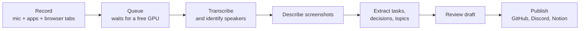

A Tauri and Rust application handles recording, the job queue and publishing. Model inference runs in a Python process that exists only while a meeting is being processed. See [docs/ARCHITECTURE.md](docs/ARCHITECTURE.md).

## Stage 0 measurements

Prototype results on the reference machine (RTX 3080 with 12 GB, Windows 10 build 19045). Test meetings are synthetic: scripted text, voices cloned from English reference voices (Polish speech therefore carries an English accent). Treat the numbers as a comparison between candidates, not as a promise for real meetings. Raw data is in [benchmarks/results](benchmarks/results); the reasoning is in the [decision records](docs/decisions/README.md).

| Area | Result | Target |
|---|---|---|
| Recording (Windows process loopback) | 0 dropped buffers in 2 h; tracks isolated to -63 dB; alignment error 27 ms; 0.03% CPU; 10 MB memory | 0 drops; -40 dB; 50 ms; 3%; 200 MB |
| Speech recognition, Whisper turbo | WER 8.9% Polish, 14.3% English, 16.4% mixed; 36 times faster than real time | 15%, 20% for mixed; 10 h in 60 min |
| Speech recognition, Whisper large-v3 | WER 11.5% Polish, 29.6% mixed; 7 times faster than real time | as above |
| Term recall of English terms, best configuration | 51% | 85% (not met) |
| Diarization, 2 to 4 speakers | DER 20.5 to 23.3% against a speech-only reference | 15% (not met) |
| Diarization, 8 speakers | DER 23.4% | 30% |
| Speaker recognition, 4 enrolled voices | 100% accuracy, unknown voice rejected | 90% |
| Task extraction, Gemma 4 12B | recall 89%, precision 95%, assignee 91%, due date 88%, all quotes verified | 80%, 80%, 85%, 85% |
| Slide description, Qwen3-VL 8B | 100% of key facts, 1.5 s per image | not set |
| 10 hours of audio, all stages | about 58 minutes (extraction extrapolated); Stage 4 measured extraction and reduce at 51.4 minutes, so about 86 minutes as an estimate | 4 hours |
| Browser tab capture | idle machine: no lost frames, longest gap 47 ms in 31 minutes; with the machine in use: gaps of 218 to 667 ms | gaps of 100 ms or less (met only when idle) |
| Python environment from lock file | 70 s and 7.4 GB for speech and diarization groups | unattended |

## Limitations

- Processing needs an NVIDIA GPU; without readings from the driver a job waits.
- Speaker separation is measured on synthetic meetings only; on 2 to 4 speakers the error rate was above the 15% target in Stage 0 and is to be confirmed on real recordings.
- Voice recognition is measured on synthetic voices only. Participants of a cycle belong to that cycle; a meeting without a cycle still uses the local list. A meeting processed after its audio was deleted has no sample clips, so voices are named from the transcript.
- The Python environment is large (about 7.4 GB) and the first model downloads take a while.
- The cloud backend is tested only against a mock server. Open issues of a cycle are read from GitHub into a cache; without a token only public repositories can be read. Edits to `cycle.yaml` and templates are not committed by the application. Extraction quality was measured on synthetic transcripts only (Gemma 4 12B: task recall 86.0%; lower in Polish and mixed meetings, 43.5% to 100% per meeting), and Qwen3 14B misses the extraction thresholds on this set. In mixed-language meetings the task text is written in the report language. The new screens are tested on the mock backend, not yet end to end in the real application.
- Stage 5 was run once against a real test repository and a real test webhook (one meeting, one correction) and is otherwise tested against fake servers and local Git repositories. The organization issue field "Target date", the Discord upload limits for webhooks and the quality of the status proposals of a real model are unverified. A meeting cannot be published twice.

## Roadmap

| Stage | Scope | Release | Status |
|---|---|---|---|
| 0 | Prototypes and decision gate | v0.1.0 | Done, gate passed |
| 1 | Recorder | v0.2.0 | Done; microphone buffer flags in the 10 hour run are open |
| 2 | Processing pipeline | v0.3.0 | Done |
| 3 | Speakers and voice profiles | v0.4.0 | Done |
| 4 | Cycles and reports | v0.5.0 | Done |
| 5 | Publishing | v0.6.0 | Done (the organization field "Target date" is unverified) |
| 6 | Convenience | v0.7.0 | Planned |
| 7 | Integrations | v0.8.0 | Planned |
| 8 | Stabilization | v1.0.0 | Planned |

Details are in [docs/ROADMAP.md](docs/ROADMAP.md).

## Documentation

- [Architecture](docs/ARCHITECTURE.md)
- [Roadmap](docs/ROADMAP.md)
- [Testing strategy](docs/TESTING.md)
- [Risks and prototypes](docs/RISKS-AND-POC.md)
- [Architecture decision records](docs/decisions/README.md)

## License

Released under the [MIT License](LICENSE).

## Author

Radosław Wójcik
