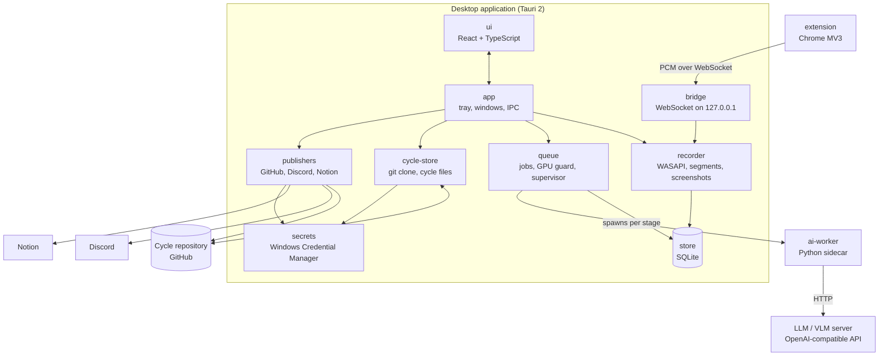
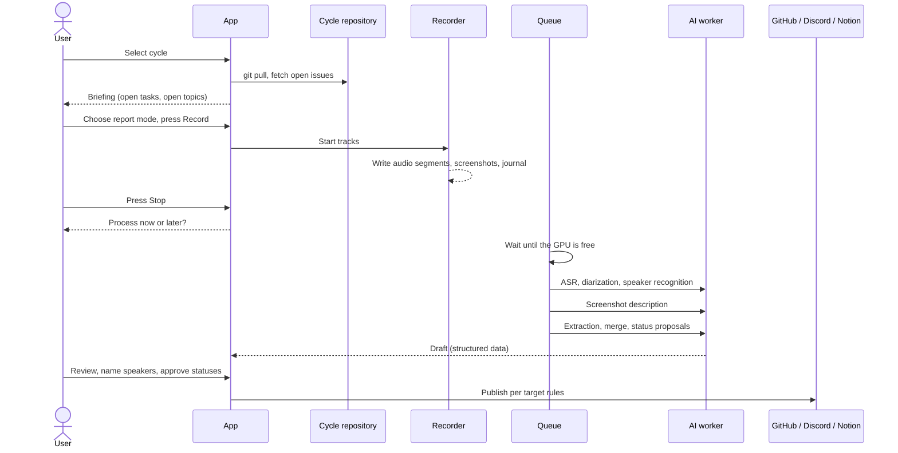
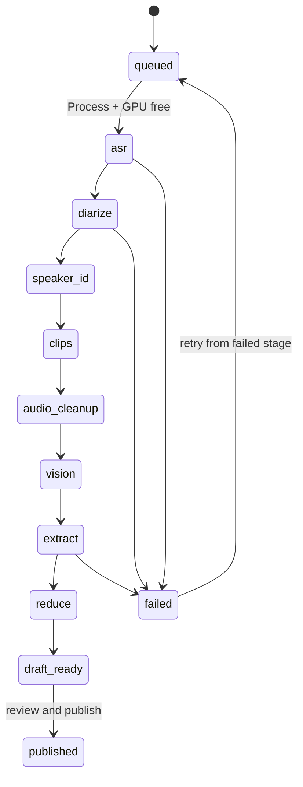

# Architecture

Blah Blah Bot is a local Windows application that records meetings, processes them after the call with locally hosted models, and publishes a structured report to the team through GitHub and Discord.

This document describes the target architecture for version 1.0. Component choices marked **pending** are confirmed or replaced at the Stage 0 decision gate (see [ROADMAP.md](ROADMAP.md) and [RISKS-AND-POC.md](RISKS-AND-POC.md)). Memory figures marked *estimate* are replaced with measurements after Stage 0.

## 1. Goals and scope

**In scope for 1.0**

- Record microphone and per-application audio as separate tracks, plus browser tabs through a Chrome extension.
- Capture region screenshots with a hotkey, timestamped against the recording.
- After the meeting: transcription (Polish, English, mixed), speaker diarization, speaker recognition from voice profiles, screenshot description, structured extraction of tasks, decisions, topics, notes, ideas and budgets.
- Meeting cycles (projects) with their own participants, glossary, templates and publishing targets.
- A Git repository as the source of truth for cycle history; tasks as GitHub Issues.
- Pre-meeting briefing, draft review, status proposals, publishing to GitHub and Discord, task export to Notion.

**Out of scope**

- Linux and macOS.
- Live transcription or any model inference while recording.
- Obtaining consent from meeting participants. This is the user's responsibility.
- Per-user voice recording through a Discord bot, and task export to Todoist and Trello. Both are candidates for a later release.

**Design principles**

1. Recording is cheap and crash-safe. All heavy work happens after the meeting.
2. Models never run at the same time. Each one runs in its own process and is unloaded before the next starts.
3. Language models produce structured data only. Markdown is rendered by deterministic code.
4. Every extracted item points back to a quote and a timestamp in the transcript.
5. Nothing leaves the machine unless the user configured a publishing target or explicitly chose a cloud backend for one meeting.

## 2. Strategy: own application built from proven components

Three options were compared: forking an existing meeting assistant, writing everything from scratch, and a hybrid.

| Criterion | Fork (Meetily) | From scratch | Hybrid (chosen) |
|---|---|---|---|
| Fit to requirements at the start | Partial: recording, transcription, summaries | None, but components cover the hard parts | Same as from scratch, plus reusable patterns |
| Live-first design | Has to be removed | Not present | Not present |
| Cycles, Git as source of truth, briefing, publishing | Missing | Built | Built |
| Upstream maintenance | Constant merging with an active upstream | None | None |

The application is written from scratch around established libraries and models. [Meetily](https://github.com/Zackriya-Solutions/meetily) (MIT) serves as a reference for the Tauri and Rust audio parts; any code taken from it is attributed in `NOTICE`. See [ADR 0001](decisions/0001-technology-stack.md).

## 3. System overview



### Data flow for one meeting



## 4. Modules

Rust modules are crates in one Cargo workspace. Licenses of third-party parts are listed in section 12.

### 4.1 `app` (Rust, Tauri 2)

- **Responsibility:** process lifetime, tray icon, recording widget, main window, global hotkeys, IPC commands exposed to the UI, single-instance lock.
- **Interfaces:** Tauri commands and events; calls into every other crate.
- **IPC conventions:** commands are snake_case and return `Result<T, IpcError>` with a stable `code` and a `message`; payloads are camelCase JSON; events (`recording-state`, `meetings-changed`) carry the complete new state. See [ADR 0014](decisions/0014-recorder-ipc-and-screenshot-overlay.md).
- **Environment switches** for development and tests: `BBB_DEMO` replaces audio capture with generated tones, `BBB_DATA_DIR` keeps all data in one folder, `BBB_LOG` sets the log filter.

### 4.2 `ui` (TypeScript, React)

- **Responsibility:** all screens. Tray widget (Record / Stop, source list), cycle list and settings, briefing, queue, transcript editor, speaker labeling, draft editor, publishing, application settings.
- **Language:** the interface is English only. The language of generated content is a separate setting (section 9).
- **Interfaces:** Tauri IPC only. The UI has no direct file, network or database access. A mock IPC layer backs UI tests and screenshot generation.

### 4.3 `recorder` (Rust)

- **Responsibility:**
  - Microphone capture and per-process loopback capture through WASAPI ([`wasapi`](https://github.com/HEnquist/wasapi-rs) crate, application loopback with process tree).
  - Listing audio sessions to offer capturable applications.
  - Adding and removing sources during a recording. Every track has its own start offset on a shared session clock.
  - Receiving browser audio from `bridge`.
  - Segmented writing and the session journal (section 7.1).
  - Region screenshot overlay; PNG files with an offset in milliseconds from recording start.
  - Meeting detection: a known conferencing process with an active audio session that also uses the microphone raises a "start recording?" prompt. Google Meet is detected by the extension.
- **Constraints:** no model inference, no network access except the local bridge. CPU and memory budgets are defined in [TESTING.md](TESTING.md).

### 4.4 `bridge` (Rust)

- **Responsibility:** WebSocket server bound to `127.0.0.1` for the Chrome extension. Receives PCM frames per tab, plus control messages (tab started, tab stopped, Meet detected).
- **Security:** one-time pairing token entered in the extension, origin check against the extension ID, no listening on external interfaces.

### 4.5 `extension` (TypeScript, Chrome Manifest V3)

- **Responsibility:** capture audio of selected tabs with `chrome.tabCapture` and an offscreen document, keep the tab audible by replaying the stream, stream PCM to `bridge`, detect `meet.google.com` tabs.
- **Tab groups:** Chrome allows capturing only tabs on which the user invoked the extension. Capturing a group therefore takes one click or shortcut per tab; the extension guides the user through the group and reports which tabs are still missing. Whole-browser capture through process loopback is the fallback. See [ADR 0008](decisions/0008-chrome-extension.md).
- **Requirements:** Chrome 116 or newer.

### 4.6 `queue` (Rust)

- **Responsibility:** persistent job queue in SQLite, one job per meeting, split into resumable stages (section 7.2). Starts on user request ("Process"), never on its own.
- **GPU guard:** reads utilization, free memory and the process list through NVML. A stage starts only when the GPU has been idle for a configurable period and enough memory is free for that stage. The guard is evaluated between stages, not during one.
- **Supervisor:** spawns the AI worker and, when configured, a local `llama-server`; enforces that only one model process exists; kills and retries on timeout.

### 4.7 `ai-worker` (Python sidecar)

Runs only while a job is processing. The environment is created with `uv` on first use and is not part of the installer.

| Step | Function | Technology |
|---|---|---|
| `asr` | Transcription per track with word timestamps | faster-whisper large-v3-turbo, language `auto` (alternative: Parakeet-TDT-0.6B-v3; large-v3 as an option) |
| `diarize` | Speaker segments per multi-speaker track | pyannote.audio 4 with `speaker-diarization-community-1` |
| `speaker-id` | Voice embeddings per detected speaker, matching against cycle voice profiles | Embedding model shipped with the diarization pipeline (**pending** API confirmation) |
| `clips` | Sample clips per detected voice for labeling | ffmpeg or direct PCM slicing |
| `merge` | One transcript from all tracks, ordered by time, with speaker and source | Own code |
| `vision` | Description of each screenshot with surrounding transcript as context | HTTP client to the VLM server |
| `extract` | Map step: structured items per transcript window | HTTP client to the LLM server, JSON Schema constrained output |
| `reduce` | Deduplication, linking to open tasks and topics, status proposals, hierarchical summary | Same |

Each step is a separate process invocation with file inputs and outputs, so a crash or restart resumes from the last completed step.

### 4.8 `store` (Rust, SQLite)

- **Responsibility:** local state: meetings, tracks, segments, job stages, drafts, voice profiles, outbox of pending publish operations, settings, cached issues.
- **Not stored here:** secrets (section 10) and anything that must be shared with the team (section 6).

### 4.9 `cycle-store` (Rust)

- **Responsibility:** local clone of the cycle repository, `git pull --rebase` before a briefing, parsing cycle files, fetching open issues with the cycle label, building the context passed to the reasoner, offline fallback with a visible "state as of" date.
- **Technology:** git CLI invoked as a subprocess; GitHub REST API for issues.

### 4.10 `publishers` (Rust)

| Target | Mechanism | Notes |
|---|---|---|
| GitHub report | Commit of new files into the meeting folder, then push | Only new files are added, which avoids merge conflicts |
| GitHub Issues | REST API: create, assign, label, close, comment | Due date in the organization "Target date" issue field when available, otherwise in the issue body |
| Discord (default) | Webhook with `allowed_mentions` | 2000 characters per message, 10 embeds, 10 files per message; long reports and many screenshots are split |
| Discord (optional) | Bot token | Member lookup by nickname, threads, editing published messages |
| Notion | Notion API, one database page per task | One-way: tasks are created, not synchronized back |

Each target has its own template and its own rule: publish automatically, or wait for approval in the draft view. Failed or offline operations go to the outbox and are retried.

### 4.11 `secrets` (Rust)

- **Responsibility:** GitHub token, Discord webhook URLs and bot token, Notion token, cloud API keys, Hugging Face token. Stored in Windows Credential Manager. Configuration files hold references to entries, never values.

## 5. Model loading order on a 12 GB GPU

Reference hardware: RTX 3080 12 GB, 32 GB RAM. Models run strictly one after another; each process exits before the next starts. VRAM values are peaks above the idle baseline from the Stage 0 prototypes (`benchmarks/results/`); after a model is released 285 to 326 MiB remain allocated, which is why stages run in separate processes. Measured on synthetic data; a ten-hour recording takes about 58 minutes end to end (extraction extrapolated).

| Order | Step | Model | VRAM (*estimate*) |
|---|---|---|---|
| 1 | ASR | faster-whisper large-v3-turbo, `int8_float16` | 1.5 GB (measured on a 10 h file) |
| 2 | Diarization and voice embeddings | pyannote community-1 | 2.3 GB (measured on a 10 h file) |
| 3 | Vision | Qwen3-VL-8B, GGUF Q4_K_M with mmproj | 7.7 GB (measured) |
| 4 | Extraction and summary | Gemma 4 12B, GGUF Q4_K_M (default; see ADR 0005) | 8.9 GB (measured) |

When an external server (Ollama, LM Studio, Strata) is configured, steps 3 and 4 call that endpoint and the application does not manage its memory. The user is responsible for the server being able to load the configured model.

## 6. Data model

### 6.1 Entities

| Entity | Key fields | Lives in |
|---|---|---|
| Cycle | id, name, participants, glossary, default report mode, templates, publishing targets, languages | Cycle repository (`cycle.yaml`) |
| Participant | id, display name, GitHub login, Discord user ID or role ID | `cycle.yaml` |
| Voice profile | participant id, embeddings, sample count | Local database only |
| Meeting | id, cycle, date, tracks, screenshots, report mode, processing state | Local database; published artifacts in the repository |
| Task | text, assignee, due date, status, issue number, source | GitHub Issue; snapshot in `meeting.json` |
| Topic | text, status (open, closed), opened in, closed in, source | `topics.yaml` |
| Decision, note, idea, budget | text, type-specific fields, source | `meeting.json`, rendered into `report.md` |
| Template | name, sections with descriptions, per-target layout | Cycle repository (`templates/`) |

Every extracted item carries `source`: track, start and end time, and a quote.

### 6.2 Files in the cycle repository

```
cycles/
  NOMAD/
    cycle.yaml          # participants, glossary, defaults, targets
    topics.yaml         # open and closed topics
    templates/
      default.md
      budget-review.md
meetings/
  NOMAD/
    2026-11-13/
      report.md         # full report
      transcript.md     # full transcript, linked from the report
      meeting.json      # structured items, machine-readable
      img/
        0001-00-12-41.png
```

A second meeting on the same day gets the suffix `-2`. `meeting.json` is what the next meeting's context is built from; `report.md` is generated from it and is never parsed back.

`cycle.yaml` (abridged):

```yaml
id: NOMAD
name: Nomad rover
languages:
  asr: auto        # auto | pl | en
  output: auto     # auto | pl | en
participants:
  - id: alex
    name: Alex Example
    github: alex-example
    discord: { user_id: "000000000000000000" }
glossary:
  - term: CAN bus
  - term: GNSS
    hint: positioning module
report:
  default_mode: fixed          # fixed | template | auto | by-type
  default_template: default
  instruction: "Group tasks by person, keep it short."
targets:
  github: { path: meetings, publish: auto }
  discord: { webhook: cred:discord/nomad, publish: on-approval, template: short }
  notion: { database: cred:notion/nomad-db, publish: on-approval }
```

### 6.3 Tasks as issues

- One issue per task, labeled `cycle:<id>`.
- Assignee from the participant's GitHub login.
- Due date: the "Target date" issue field for repositories owned by an organization; otherwise a `Due: YYYY-MM-DD` line in the body.
- A hidden marker in the body links the issue to the meeting and the transcript position.
- Closing an issue on GitHub marks the task as done at the next pull. Status changes approved in the draft view are written back through the API (close, reopen, comment).

### 6.4 Extraction schema

The map step returns a list of items validated against a JSON Schema. Abridged shape:

```json
{
  "type": "task",
  "text": "Design the monitor mount",
  "assignee": "alex",
  "due": "2026-11-20",
  "certainty": { "assignee": "stated", "due": "inferred" },
  "relates_to": null,
  "source": {
    "track": "app:discord",
    "t_start_ms": 754000,
    "t_end_ms": 761500,
    "quote": "Alex, can you have the mount ready by next Friday?"
  }
}
```

- `type`: `task`, `decision`, `topic`, `note`, `idea`, `budget`.
- `certainty`: `stated`, `inferred` or `unknown` per uncertain field.
- `relates_to`: an open issue number or topic id when the item continues earlier work.
- Status proposals are a second list: target (issue or topic), proposed status (`done`, `in_progress`, `postponed`, `closed`), and `source`.

Schemas are versioned files under `schemas/` and are the contract between the Python worker, the Rust core and the UI.

## 7. Processing

### 7.1 Recording format and crash safety

- Each track is written as 16 kHz mono 16-bit PCM in 60-second segments (about 115 MB per track per hour). FLAC is evaluated in Stage 0 as a smaller alternative.
- A session journal (append-only, flushed after every segment) records tracks, offsets, segments, screenshots and source changes. The database is filled by replaying the journal, both when a recording stops and when a crashed one is recovered.
- After a crash or power loss the journal is replayed on next start; at most the last unfinished segment is lost. The meeting appears in the queue as recoverable.

### 7.2 Job stages



Each stage writes its output to the meeting's working folder and records completion in the database. Stages are idempotent and resumable.

### 7.3 Audio retention

- Full audio is deleted automatically once transcription, diarization, voice embedding and clip extraction have all succeeded.
- A few short sample clips per detected voice are kept until the speakers of that meeting are confirmed, then deleted. An upper retention limit applies if labeling is never completed.
- An optional setting keeps full audio for a number of days. It is off by default.
- After deletion the only correction path is editing the transcript.

### 7.4 Speakers and voice profiles

1. The microphone track is attributed to the user without diarization.
2. Every other track is diarized. The number of speakers is bounded by the cycle's participant list.
3. For each detected voice an embedding is computed and compared with the cycle's voice profiles. A strong match assigns the name automatically; a weak match becomes a suggestion; no match yields an unknown voice.
4. The labeling screen lists detected voices, each with sample clips of clear, non-overlapping speech. The user plays a clip and picks a participant, creates a new one, or merges two voices.
5. Confirmed labels update the voice profiles, so recognition improves with every meeting.

Voice profiles are biometric data. They are stored only in the local database, are never committed or published, and can be deleted per participant or per cycle.

Diarization accuracy drops sharply with many speakers in one mixed track. Above roughly eight speakers the application relies on separate source tracks, voice profiles, the participant-bound speaker count and fast manual merging rather than on automatic separation.

### 7.5 Long transcripts

1. Split the merged transcript into windows of 15–20 minutes with a one-minute overlap, cut at silence where possible.
2. **Map:** extract items per window against the schema. Use server-side JSON Schema or grammar constraints when available; otherwise validate and retry.
3. **Verify:** fuzzy-match every quote against the transcript near its timestamp. Items without a match are flagged for review.
4. **Reduce:** deduplicate across windows, link items to open issues and topics from the cycle context, produce status proposals.
5. **Summarize:** hierarchical summary (windows, then hours, then the whole meeting).
6. **Render:** deterministic templates produce `report.md` and the per-target variants.

The user can mark transcript passages as excluded before step 1; excluded text is not sent to the model and is omitted from the published transcript.

### 7.6 Report modes and format customization

One template engine serves all modes:

| Mode | Behavior |
|---|---|
| Fixed | Built-in sections: tasks, decisions, notes, ideas, budgets |
| Template | User-defined sections with descriptions; the model fills them |
| Auto | The model proposes sections for this meeting; the user can change them |
| By type | A set of templates keyed by meeting type (technical, budget, casual) |

Choosing a mode is required before recording starts; the cycle supplies the default. Format is further adjusted by a Markdown template with placeholders such as `{tasks}` and `{decisions}`, a natural-language instruction stored in the cycle, manual editing of the draft (including moving items between sections), and a separate template per publishing target.

### 7.7 Trust signals

Kept visually quiet so they do not dominate the report:

- every task, decision and topic links to its transcript position and quote;
- fields the model inferred, and items whose quote could not be verified, carry a small marker in the draft view;
- the published report links to the full transcript in the repository.

## 8. Model backends

| Backend | Use | Configuration |
|---|---|---|
| Managed `llama-server` | Default for LLM and vision | Path to GGUF files; started and stopped by the queue |
| External OpenAI-compatible server (Ollama, LM Studio, Strata, others) | LLM and optionally vision | Base URL, model name, optional key |
| Cloud (OpenAI-compatible endpoints; other providers through adapters) | LLM only, chosen per meeting | API key in Credential Manager |

- There is no automatic fallback to the cloud. Cloud processing is a per-meeting choice confirmed in a dialog that states what will be sent.
- Screenshot description always runs locally. Only transcript text and screenshot descriptions are sent to a cloud model.
- Strata is supported as an external server. Its main model needs more memory than the reference machine has, so it is not a default and is not covered by release benchmarks.

See [ADR 0005](decisions/0005-llm-backend.md).

## 9. Languages

- **Interface:** English only.
- **Transcription language** (per cycle): `auto`, `pl` or `en`. The default is `auto` with no glossary in the ASR prompt (Stage 0: forcing the language did not change turbo's result, and the glossary did not improve term recall, so it stays optional). The translation rate on mixed speech was 1.3% at best against a 1% requirement; it is re-measured on real recordings.
- **Output language** (per cycle, overridable per meeting): `auto`, `pl` or `en`. `auto` writes the report in the dominant language of the meeting.
- The cycle glossary is passed to the ASR prompt and to the extraction prompt.

## 10. Privacy and security

- **Local by default.** No telemetry. Network access is limited to the configured cycle repository, publishing targets, model downloads and, when chosen, a cloud model.
- **Secrets** live in Windows Credential Manager. They never appear in configuration files, logs, the database or the repository.
- **Audio** is deleted after processing (section 7.3).
- **Voice profiles** stay on the machine (section 7.4).
- **Transcripts** contain personal data. Before the first publication to a public repository the application shows a warning and requires confirmation.
- **Bridge** accepts only local, paired connections.
- **Model weights** are downloaded on first use with the user's own Hugging Face token where a model is gated. Nothing is redistributed with the application.
- **Paths** are resolved from the user profile and settings. No absolute paths are compiled in.

## 11. Errors and recovery

| Situation | Behavior |
|---|---|
| Crash or power loss while recording | Journal replay; at most one segment lost; meeting recoverable |
| Audio device removed or application closed mid-recording | Track ends, others continue; event recorded in the journal; tray notification |
| GPU busy | Job waits between stages; the user sees the reason |
| Worker crash or timeout | Stage marked failed; retry resumes from that stage |
| Invalid model output | Validation, bounded retries, then the window is flagged and skipped with a visible warning |
| No network at briefing | Cached clone and cached issues, with a "state as of" date |
| No network at publishing | Operation stored in the outbox and retried |
| Push rejected | `pull --rebase` and retry; meeting folders contain only new files |
| Conflict in `topics.yaml` | Last write wins per topic; differences shown in the UI |
| Discord limit exceeded | Message and attachments split automatically |

## 12. Third-party components and licenses

| Component | Role | License | Status |
|---|---|---|---|
| Tauri 2 | Application shell | Apache-2.0 OR MIT | Confirmed (crates.io, 2.12.5) |
| `wasapi` crate | Audio capture | MIT | Confirmed (0.27.0) |
| `windows` crate | Win32 bindings | MIT OR Apache-2.0 | Confirmed (0.62.2) |
| `nvml-wrapper`, `keyring` crates | GPU guard, secret storage | MIT OR Apache-2.0 | Confirmed (0.13.0, 4.2.0) |
| faster-whisper, Whisper large-v3 | ASR | MIT | Confirmed (1.2.1) |
| Parakeet-TDT-0.6B-v3 | ASR alternative | CC-BY-4.0 | Confirmed |
| pyannote.audio | Diarization toolkit | MIT | Confirmed (4.0.7) |
| speaker-diarization-community-1 | Diarization weights | CC-BY-4.0, gated download | Confirmed |
| Qwen3-VL-8B | Screenshot description | Apache-2.0 | Confirmed |
| Bielik 11B v3 | Dropped | Apache-2.0 for the weights; publisher terms of use v1.1 list "processing any personal data" as a prohibited use | Not used: meeting transcripts contain personal data (ADR 0012) |
| Gemma 4 12B (GGUF Q4_K_M) | Default LLM | Apache-2.0 (third-party GGUF conversion) | Confirmed, measured in Stage 0 |
| Whisper large-v3-turbo | Default ASR | MIT | Confirmed, measured in Stage 0 |
| llama.cpp | Model server | MIT | Confirmed |
| uv | Python environment management | MIT OR Apache-2.0 | Confirmed |

Rules:

- Only models under licenses compatible with an MIT project are defaults. Non-commercial weights (for example DiariZen) are excluded.
- Models under other licenses (for example Qwen3.8-Flash-Next under the Qwen Community License) can be used through an external server the user sets up; the application neither downloads nor recommends them.
- `NOTICE` lists attributions for dependencies and for every model the application can download. CC-BY-4.0 requires attribution.

## 13. System requirements

| | Minimum | Reference |
|---|---|---|
| OS | Windows 10 version 2004 or newer (process loopback verified on build 19045), Windows 11 (**pending** verification) | Windows 11 |
| GPU | NVIDIA with 8 GB VRAM (smaller models) | RTX 3080 12 GB |
| RAM | 16 GB | 32 GB |
| Disk | SSD; space for models and about 115 MB per track per recorded hour | NVMe |
| Browser capture | Chrome 116+ | |

Recording works without a GPU. Processing without an NVIDIA GPU is not a 1.0 target.
