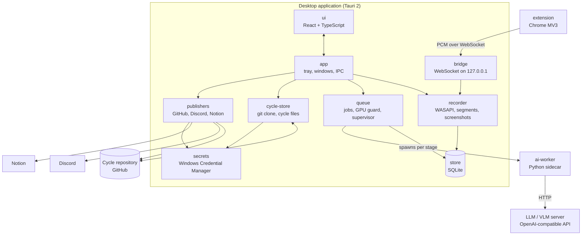
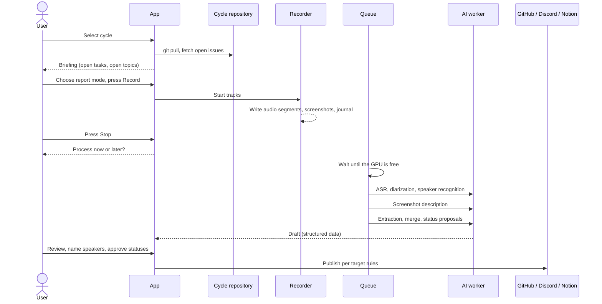
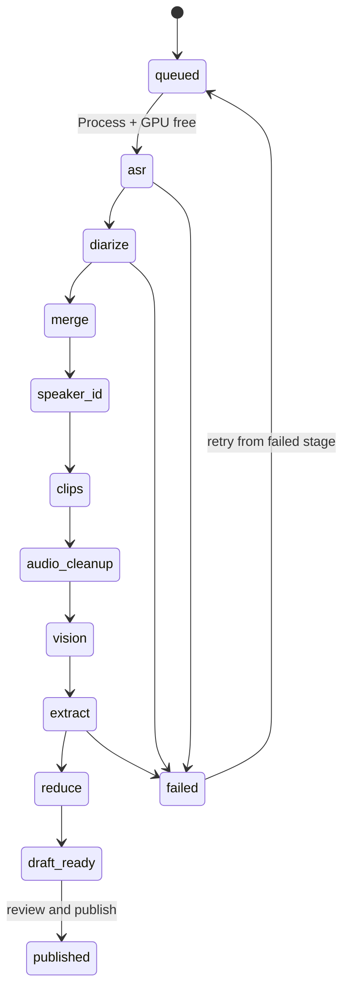

# Architecture

Blah Blah Bot is a local Windows application that records meetings, processes them after the call with locally hosted models, and publishes a structured report to the team through GitHub and Discord.

This document describes the target architecture for version 1.0. Component choices marked **pending** are confirmed or replaced at the Stage 0 decision gate (see [ROADMAP.md](ROADMAP.md) and [RISKS-AND-POC.md](RISKS-AND-POC.md)). Memory figures marked *estimate* are replaced with measurements after Stage 0.

## 1. Goals and scope

**In scope for 1.0**

- Record microphone and per-application audio as separate tracks, plus browser tabs through a Chrome extension.
- Capture region screenshots with a hotkey, timestamped against the recording.
- After the meeting: transcription (Polish, English, mixed), speaker diarization, speaker recognition from voice profiles, screenshot description, structured extraction of tasks, decisions, topics, notes, ideas and budgets.
- Meeting cycles (projects) with their own participants, glossary, templates and publishing targets.
- A Git repository as the source of truth for cycle history; tasks as GitHub Issues.
- Pre-meeting briefing, draft review, status proposals, publishing to GitHub and Discord, task export to Notion.

**Out of scope**

- Linux and macOS.
- Live transcription or any model inference while recording.
- Obtaining consent from meeting participants. This is the user's responsibility.
- Per-user voice recording through a Discord bot, and task export to Todoist and Trello. Both are candidates for a later release.

**Design principles**

1. Recording is cheap and crash-safe. All heavy work happens after the meeting.
2. Models never run at the same time. Each one runs in its own process and is unloaded before the next starts.
3. Language models produce structured data only. Markdown is rendered by deterministic code.
4. Every extracted item points back to a quote and a timestamp in the transcript.
5. Nothing leaves the machine unless the user configured a publishing target or explicitly chose a cloud backend for one meeting.

## 2. Strategy: own application built from proven components

Three options were compared: forking an existing meeting assistant, writing everything from scratch, and a hybrid.

| Criterion | Fork (Meetily) | From scratch | Hybrid (chosen) |
|---|---|---|---|
| Fit to requirements at the start | Partial: recording, transcription, summaries | None, but components cover the hard parts | Same as from scratch, plus reusable patterns |
| Live-first design | Has to be removed | Not present | Not present |
| Cycles, Git as source of truth, briefing, publishing | Missing | Built | Built |
| Upstream maintenance | Constant merging with an active upstream | None | None |

The application is written from scratch around established libraries and models. [Meetily](https://github.com/Zackriya-Solutions/meetily) (MIT) serves as a reference for the Tauri and Rust audio parts; any code taken from it is attributed in `NOTICE`. See [ADR 0001](decisions/0001-technology-stack.md).

## 3. System overview



### Data flow for one meeting



## 4. Modules

Rust modules are crates in one Cargo workspace. Licenses of third-party parts are listed in section 12.

### 4.1 `app` (Rust, Tauri 2)

- **Responsibility:** process lifetime, tray icon, recording widget, main window, global hotkeys, IPC commands exposed to the UI, single-instance lock.
- **Interfaces:** Tauri commands and events; calls into every other crate.
- **IPC conventions:** commands are snake_case and return `Result<T, IpcError>` with a stable `code` and a `message`; payloads are camelCase JSON; events (`recording-state`, `meetings-changed`) carry the complete new state. See [ADR 0014](decisions/0014-recorder-ipc-and-screenshot-overlay.md).
- **Environment switches** for development and tests: `BBB_DEMO` replaces audio capture with generated tones, `BBB_DATA_DIR` keeps all data in one folder, `BBB_LOG` sets the log filter.

### 4.2 `ui` (TypeScript, React)

- **Responsibility:** all screens. Tray widget (Record / Stop, source list), cycle list and settings, briefing, queue, transcript editor, speaker labeling, draft editor, publishing, application settings.
- **Language:** the interface is English only. The language of generated content is a separate setting (section 9).
- **Interfaces:** Tauri IPC only. The UI has no direct file, network or database access. A mock IPC layer backs UI tests and screenshot generation.

### 4.3 `recorder` (Rust)

- **Responsibility:**
  - Microphone capture and per-process loopback capture through WASAPI ([`wasapi`](https://github.com/HEnquist/wasapi-rs) crate, application loopback with process tree).
  - Listing audio sessions to offer capturable applications (`source_list`: sessions of one program become one source on its topmost process; Google Chrome becomes the source `Chrome (whole browser)` on its real top process, found through the parent chain, because the audio service that plays is a helper of the browser process; other browsers stay ordinary applications, whole-browser capture is Chrome only), and polling playback and microphone sessions (`SessionMonitor`): each session is tied to its application through the parent chain of its process (the new Teams plays from an `msedgewebview2` child of `ms-teams.exe`), and only the owners of new sessions and their parents are looked up.
  - Adding and removing sources during a recording. Every track has its own start offset on a shared session clock.
  - Receiving browser audio from `bridge`: a tab is a pushed track (`push.rs`) placed by sample count; missing frames become silence journaled as `stream_gap`, and the sender clock feeds drift correction and fills capture stalls longer than 1 s. `RoutingBackend` sends tab sources to a `TabSource` and everything else to the capture backend.
  - Segmented writing and the session journal (section 7.1).
  - Region screenshot overlay; PNG files with an offset in milliseconds from recording start.
  - Meeting detection (`detect.rs`, pure rules, replayed from traces by `detect_trace.rs`): a known conferencing application (Discord, Teams, Zoom, Slack; a setting) that uses the microphone for the sustain time, and has the playback session the sensitivity asks for, raises one "start recording?" prompt per call (`Idle -> Candidate -> Prompted -> Cooldown`); the call ends when the microphone was unused for the end-of-call time; no prompt while the application is recorded or after the user opted out; browsers are excluded from this rule. Google Meet is detected by the extension and goes through the same engine. Sensitivity (low, balanced, default balanced) is a table of numbers in `Presets` ([ADR 0022](decisions/0022-meeting-detection.md)). Enumeration only: no audio is opened.
- **Constraints:** no model inference, no network access except the local bridge. CPU and memory budgets are defined in [TESTING.md](TESTING.md).

### 4.4 `bridge` (Rust)

- **Responsibility:** WebSocket server (blocking, [tungstenite](https://github.com/snapview/tungstenite-rs)) bound to `127.0.0.1` for the Chrome extension, port 17555 with fallbacks 17556 to 17564. One connection carries every captured tab: JSON control messages (pairing, stream start, resume, stop, Meet, tab group, heartbeat, recording state) and binary audio frames (16-byte header `stream_no | seq | sent_ms`, then 16 kHz mono 16-bit PCM). Protocol version 2, schema `schemas/bridge-message.schema.json`, fixtures shared with the extension tests. See [ADR 0020](decisions/0020-bridge-protocol-and-pairing.md).
- **Parts:** `protocol` (messages, frame layout, limits), `pairing` (codes, secrets), `server` and `conn` (socket, upgrade checks, message loop), `hub` (paired clients, connections, streams; hands each stream's frames to the recorder and keeps a stream 30 s for `resume` after a lost connection). `examples/test_receiver` runs the bridge alone for extension tests.
- **Pairing:** the user starts pairing in Settings; an 8-character code is valid 5 minutes, works once and locks after 5 wrong attempts. The extension receives a client id and a 32-byte secret; the application keeps the SHA-256 of the secret in the settings. Unpairing closes the extension's connections.
- **Security:** loopback peers only, `Host` must name `127.0.0.1` or `localhost` with the bound port, `Origin` must be an extension (from the allowed ids once set), two connections at most, size limits (16 KiB text, 9.6 KB audio per frame), a connection silent for 15 s is closed.
- **Tabs on offer:** a tab that asks while nothing records, or that the application declines, is refused but kept by the hub as on offer (`HubStatus.offered`, with title, host and tab group), until it is taken, the extension stops it (a closed tab), or its connection ends. A refusal changes no state, so it is not answered with a `state` message (which would make the waiting tab ask again at once); `announce_state` sends the state again when a tab on offer is added by hand.
- **Application side:** `crates/app/src/browser.rs` starts the server from `settings.bridge`, stores pairings, tells the hub whether a recording runs and adds an accepted tab to it as the source `tab:<stream id>` (Tauri commands `bridge_status`, `start_pairing`, `cancel_pairing`, `unpair_client`; event `bridge-changed`). The source list (`list_sources`) adds the tabs on offer and the recorded ones to the sources of the system: `Tab: <title> (<host>)` in the picker, the tab group as `Group n`, and a `hint` on the whole-browser source that names why it is on offer (extension turned off, not paired, not connected, a tab failed); `sources.rs` holds these as pure functions. What is stored with a recording and can be published carries the host alone (`Tab: <host>`), never the title. A recording started from the picker takes the tabs that stay ticked and leaves the other tabs on offer out (they stay in "Add source"); a tab captured after the recording started joins at once (`autoAddTabs`); adding a tab by hand takes it whatever `autoAddTabs` says.

### 4.5 `extension` (TypeScript, Chrome Manifest V3)

- **Responsibility:** capture audio of selected tabs with `chrome.tabCapture` and an offscreen document, keep the tab audible by replaying the stream, stream PCM to `bridge`, detect `meet.google.com` tabs.
- **Parts (`extension/src`):**
  - `service-worker` keeps no state of its own (pairing in `chrome.storage.local`, Meet and capture bookkeeping in `chrome.storage.session`): it handles the popup, the `capture-tab` shortcut (Alt+Shift+R), tab events and the badge, and asks `tabCapture` for a stream id (retrying for up to 2 s while a tab is still being released).
  - `offscreen` (reason `USER_MEDIA`) owns the WebSocket and every stream: `bridge-client` (reconnect with 0.5 s to 5 s backoff over the ports 17555 to 17564, heartbeat, pairing), `mux` (two audio contexts: playback so the tab stays audible, 16 kHz capture into the `pcm-worklet`), and one `session` per stream (start or resume handshake, sequence numbers, a 30 s buffer while disconnected that is drained at a limited rate after `resume`).
  - `popup` (pairing, capture toggle, status, the tab group list with "Capture this group" and "Next tab"), `groups` (pure group logic), `meet` (URL matcher, joined and left rules), `protocol` (messages and frame layout, tested against the shared fixtures of `crates/bridge/tests/fixtures`), `retry`, `ipc` (internal messages).
- **Connection and recording state:** a stream is accepted only while the application records. While it is idle the application refuses the tab (`not_recording`) and lists it on offer; the capture waits, offers the tab again after every reconnect, tells the application when the tab is closed, and starts when the application reports a recording; it stops when the recording ends. A lost connection, a restarted application and a stopped service worker do not end a stream.
- **Meet:** a tab on a call URL (`xxx-xxxx-xxx`) that becomes audible is reported to the application as `meet{joined}` with its host, and as `left` when the URL leaves the call or the tab closes; the only host permission is `https://meet.google.com/*`.
- **Tab groups:** Chrome allows capturing only tabs on which the user invoked the extension. Capturing a group therefore takes one click or shortcut per tab; the extension guides the user through the group (Stage 6, milestone M3). `groups` derives the status of each tab (`captured`, `waiting`, `not_audible`, `failed`) from the captured set, the failed marks and `tab.audible`, picks the next tab to visit (sound first, then silent, then failed, walking right from the current tab) and builds the `group{group_id, tabs[{tab_id, status}]}` message (silent tabs are `waiting`; no title, no address). The service worker tracks the groups the user captures from (`chrome.storage.session`), recomputes them on every tab event (joined or left a group, audible, closed, moved) and on every capture or stop, shows the number of waiting tabs as the global badge (`+1`), and gives the offscreen document the message, which sends it when it changed and again after each reconnect. The `capture-tab` shortcut captures the current tab and then activates the next missing one; closing a captured tab stops its stream with reason `tab_closed`. The application side (a group line such as "Group X: 3/4 tabs" in the tray) is not built yet: the hub already hands the message to the observer. Whole-browser capture through process loopback is the fallback. See [ADR 0008](decisions/0008-chrome-extension.md).
- **Build and distribution:** plain `tsc` (no bundler), `npm run build` assembles `target/extension/unpacked`, `npm run pack` zips it for the release; the test build adds a hook for synthetic streams and is never packaged. The extension is installed unpacked from the release zip and is not published in the Chrome Web Store ([ADR 0021](decisions/0021-extension-distribution.md)); its id follows from the key in the manifest.
- **Requirements:** Chrome 116 or newer.

### 4.6 `queue` (Rust)

- **Responsibility:** persistent job queue in SQLite, one job per meeting, split into resumable stages (section 7.2). Starts on user request ("Process"), never on its own.
- **GPU guard:** reads utilization, free memory and the process list through NVML. A stage starts only when the GPU has stayed below a utilization limit for a configurable period (defaults 40 % and 10 s) and enough memory is free for that stage (3.0, 3.5 and 9.5 GB for ASR, diarization and vision; `extract` and `reduce` need 9.5 GB as well, but only with the managed `llama-server`, an external or cloud backend skips the guard). The guard is evaluated between stages, not during one; the reason for waiting is shown in the queue. Without NVML readings the job waits. See [ADR 0015](decisions/0015-processing-pipeline.md).
- **Supervisor:** runs one stage at a time (a second request is refused while a stage runs), spawns the AI worker, which starts the local `llama-server` for the vision step itself; kills the whole process tree on timeout; a stage interrupted by a crash resumes after the restart and is marked failed after three crashes in a row, and a failed stage waits for an explicit retry.

### 4.7 `ai-worker` (Python sidecar)

Runs only while a job is processing. The environment is created with `uv` on first use and is not part of the installer.

| Step | Function | Technology |
|---|---|---|
| `asr` | Transcription per track with word timestamps | faster-whisper large-v3-turbo, language `auto` (alternative: Parakeet-TDT-0.6B-v3; large-v3 as an option) |
| `diarize` | Speaker segments per multi-speaker track | pyannote.audio 4 with `speaker-diarization-community-1` |
| `merge` | One transcript from all tracks, ordered by time, with speaker and source | Own code |
| `vision` | Description of each screenshot with surrounding transcript as context | HTTP client to the VLM server |
| `extract` | Map step: structured items per transcript window | HTTP client to the LLM server, JSON Schema constrained output |
| `reduce` | Deduplication, linking to open tasks and topics, status proposals, hierarchical summary | Same |

Each step is a separate process invocation with file inputs and outputs, so a crash or restart resumes from the last completed step. Stage 2 implements `asr`, `diarize`, `merge` and `vision`, Stage 4 `extract` and `reduce` (reading `work/context.json`, `work/transcript.named.json` and `edits.json`, writing `work/extract/windows.json` and `work/draft.json`, or `work/draft.new.json` when the existing draft has user edits); the application also runs a `models` command (download with progress, cache status). The contract (manifest, outputs, progress lines, schemas under `schemas/`) is described in [ADR 0015](decisions/0015-processing-pipeline.md).

### 4.8 `store` (Rust, SQLite)

- **Responsibility:** local state: meetings, tracks, segments, job stages, drafts, voice profiles, outbox of pending publish operations, settings, cached issues.
- **Not stored here:** secrets (section 10) and anything that must be shared with the team (section 6).

### 4.9 `cycle-store` (Rust)

- **Responsibility:** the cycle repository: a local clone of a remote or a local-only repository, `git pull --rebase` before the `extract` stage, parsing and validating cycle files, building the context passed to the reasoner, the draft types and the deterministic report renderer, offline fallback with a visible "state as of" date.
- **Implemented API areas:** repository (`Repo`: open, initialize a local repository, clone, pull with uncommitted edits set aside, status, list cycles with their validation issues, load and save a cycle, topics and templates); `cycle` and `topics` (parse, validate against `schemas/cycle.schema.json` and `schemas/topics.schema.json`, write in a stable key order); `template` (front matter sections, placeholders, validation); `context` (`work/context.json`: cycle, open topics, open issues and the items of previous meetings, newest first, at most 80); `draft` and `render` (meeting draft types and the template engine for the report and the per-target variants); `issues` (open-issue list with a cache and a fetch function).
- **Cache and state:** the date of the last successful pull and the last error are kept in `.git/bbb-cache.json`; the open-issue list of a cycle in `.git/bbb-issues-<ID>.json`. Both are inside `.git`, so they never appear in the working tree or in a commit.
- **Offline behaviour:** the working tree is the cache. A failed pull (no network, no upstream, a conflict) leaves the clone as it was, aborts an interrupted rebase and records the reason; the interface shows "state as of <date>". A local-only repository has nothing to pull. Without the `git` CLI cycle repositories cannot be used.
- **Open issues:** the crate can fetch them from the GitHub REST API (pull requests excluded, up to 500) and falls back to the cached list. The application currently builds the context from the cache only and has no setting for a GitHub token, so fetching is not yet wired in; issues are read only.
- **Technology:** git CLI invoked as a subprocess; GitHub REST API for issues.

### 4.10 `publishers` (Rust)

| Target | Mechanism | Notes |
|---|---|---|
| GitHub report | Commit of new files into the meeting folder, then push | Only new files are added, which avoids merge conflicts |
| GitHub Issues | REST API: create, assign, label, close, comment | Due date in the organization "Target date" issue field when available, otherwise in the issue body |
| Discord (default) | Webhook with `allowed_mentions` | 2000 characters per message, 10 embeds, 10 files per message; long reports and many screenshots are split |
| Discord (optional) | Bot token | Member lookup by nickname, threads, editing published messages |
| Notion | Notion API, one database page per task | One-way: tasks are created, not synchronized back |

Each target has its own template and its own rule: publish automatically, or wait for approval in the draft view. Failed or offline operations go to the outbox and are retried.

### 4.11 `secrets` (Rust)

- **Responsibility:** GitHub token, Discord webhook URLs and bot token, Notion token, cloud API keys, Hugging Face token. Stored in Windows Credential Manager. Configuration files hold references to entries, never values.

## 5. Model loading order on a 12 GB GPU

Reference hardware: RTX 3080 12 GB, 32 GB RAM. Models run strictly one after another; each process exits before the next starts. VRAM values are peaks above the idle baseline from the Stage 0 prototypes (`benchmarks/results/`); after a model is released 285 to 326 MiB remain allocated, which is why stages run in separate processes. Measured on synthetic data; for a ten-hour recording extraction and reduce were measured at 51.4 minutes (Stage 4), which with the Stage 0 transcription and diarization times gives about 86 minutes end to end as an estimate (see ADR 0007).

| Order | Step | Model | VRAM (*estimate*) |
|---|---|---|---|
| 1 | ASR | faster-whisper large-v3-turbo, `int8_float16` | 1.5 GB (measured on a 10 h file) |
| 2 | Diarization and voice embeddings | pyannote community-1 | 2.3 GB (measured on a 10 h file) |
| 3 | Vision | Qwen3-VL-8B, GGUF Q4_K_M with mmproj | 7.7 GB (measured) |
| 4 | Extraction and summary | Gemma 4 12B, GGUF Q4_K_M (default; see ADR 0005) | 9.2 GB (measured on a 10 h transcript, Stage 4) |

When an external server (Ollama, LM Studio, Strata) is configured, steps 3 and 4 call that endpoint and the application does not manage its memory. The user is responsible for the server being able to load the configured model.

## 6. Data model

### 6.1 Entities

| Entity | Key fields | Lives in |
|---|---|---|
| Cycle | id, name, participants, glossary, default report mode, templates, publishing targets, languages | Cycle repository (`cycle.yaml`) |
| Participant | id, display name, GitHub login, Discord user ID or role ID | `cycle.yaml` |
| Voice profile | participant id, embeddings, sample count | Local database only |
| Meeting | id, cycle, date, tracks, screenshots, report mode, processing state | Local database; published artifacts in the repository |
| Task | text, assignee, due date, status, issue number, source | GitHub Issue; snapshot in `meeting.json` |
| Topic | text, status (open, closed), opened in, closed in, source | `topics.yaml` |
| Decision, note, idea, budget | text, type-specific fields, source | `meeting.json`, rendered into `report.md` |
| Template | name, sections with descriptions, per-target layout | Cycle repository (`templates/`) |

Every extracted item carries `source`: track, start and end time, and a quote.

### 6.2 Files in the cycle repository

```
cycles/
  NOMAD/
    cycle.yaml          # participants, glossary, defaults, targets
    topics.yaml         # open and closed topics
    templates/
      default.md
      budget-review.md
meetings/
  NOMAD/
    2026-11-13/
      report.md         # full report
      transcript.md     # full transcript, linked from the report
      meeting.json      # structured items, machine-readable
      img/
        0001-00-12-41.png
```

A second meeting on the same day gets the suffix `-2`. `meeting.json` is what the next meeting's context is built from; `report.md` is generated from it and is never parsed back.

`cycle.yaml` (abridged):

```yaml
id: NOMAD
name: Nomad rover
languages:
  asr: auto        # auto | pl | en
  output: auto     # auto | pl | en
participants:
  - id: alex
    name: Alex Example
    github: alex-example
    discord: { user_id: "000000000000000000" }
glossary:
  - term: CAN bus
  - term: GNSS
    hint: positioning module
report:
  default_mode: fixed          # fixed | template | auto | by-type
  default_template: default
  instruction: "Group tasks by person, keep it short."
  by_type:                     # meeting type -> template name
    budget: budget-review
targets:
  github: { path: meetings, publish: auto }   # publish: auto | on-approval | off
  discord: { webhook: cred:discord/nomad, publish: on-approval, template: short }
  notion: { database: cred:notion/nomad-db, publish: on-approval }
```

Only `id` and `name` are required; unknown keys are rejected. The full field reference is in [CYCLES.md](CYCLES.md) and the definition in `schemas/cycle.schema.json`.

### 6.3 Tasks as issues

- One issue per task, labeled `cycle:<id>`.
- Assignee from the participant's GitHub login.
- Due date: the "Target date" issue field for repositories owned by an organization; otherwise a `Due: YYYY-MM-DD` line in the body.
- A hidden marker in the body links the issue to the meeting and the transcript position.
- Closing an issue on GitHub marks the task as done at the next pull. Status changes approved in the draft view are written back through the API (close, reopen, comment).

### 6.4 Extraction schema

Two schemas under `schemas/` describe the result.

**`extraction.schema.json`** is what the model returns for one transcript window (map step): a `summary` of the window and a list of `items`. The server constrains the output to it and the worker validates it again. An item:

```json
{
  "type": "task",
  "text": "Design the monitor mount",
  "assignee": "alex",
  "due": "2026-11-20",
  "certainty": { "assignee": "stated", "due": "inferred" },
  "section": null,
  "relates_to": null,
  "time": "00:12:34",
  "quote": "Alex, can you have the mount ready by next Friday?"
}
```

**`meeting.schema.json`** is the draft (`work/draft.json`, later `meeting.json`): `version`, `meeting_id`, `cycle`, `date`, the resolved output `language` (`pl` or `en`), `mode`, `template`, `meeting_type`, `sections` (`id`, `title`, `description`), `summary`, `items` and `warnings`. An item of the draft has:

- `id`, `type`, `text`, `assignee` (a participant id or `null`), `due` (`YYYY-MM-DD` or `null`), `section` (a section id or `null`), `relates_to` (an open topic or issue id, or `null`) and `edited` (set when the user changed the item);
- `type`: `task`, `decision`, `topic`, `note`, `idea`, `budget`;
- `certainty`: `stated`, `inferred` or `unknown`, separately for `assignee` and `due`;
- `source`, or `null` for an item added by hand: `track`, `speaker`, `t_start_ms`, `t_end_ms`, the `quote`, `verified` (the quote was found in the transcript near the stated time) and `match` (similarity from 0 to 1 to the best matching transcript text). The time range comes from the matched transcript segments, not from the model.

`warnings` carry a `code` (`window_skipped`, `quote_unverified`, `assignee_unknown`, `summary_failed`), a message and an optional time range. Status proposals for issues and topics are not part of the Stage 4 schema; they arrive with publishing (Stage 5).

Schemas are versioned files under `schemas/` and are the contract between the Python worker, the Rust core and the UI.

## 7. Processing

### 7.1 Recording format and crash safety

- Each track is written as 16 kHz mono 16-bit PCM in 60-second segments (about 115 MB per track per hour). FLAC is evaluated in Stage 0 as a smaller alternative.
- A session journal (append-only, flushed after every segment) records tracks, offsets, segments, screenshots and source changes. The database is filled by replaying the journal, both when a recording stops and when a crashed one is recovered.
- After a crash or power loss the journal is replayed on next start; at most the last unfinished segment is lost. The meeting appears in the queue as recoverable.

### 7.2 Job stages



Each stage writes its output to the meeting's working folder and records completion in the database. Stages are idempotent and resumable. Stage 3 adds `speaker_id` and `clips`, Stage 4 adds `extract` and `reduce`, so the pipeline runs `asr`, `diarize`, `merge`, `speaker_id`, `clips`, `audio_cleanup`, `vision`, `extract` and `reduce`. `extract` and `reduce` take their backend from `options.llm` of the job (`managed`, `external` or `cloud`); a managed backend passes the GPU gate, the others do not, and a cloud backend runs only when the store holds the user's confirmation for that endpoint (the supervisor refuses otherwise, and the worker too). A job whose meeting has no cycle, or whose options name no backend, marks both stages done with a note instead of failing, so older jobs and cycle-less meetings still finish. Before `extract` the application writes `work/context.json` and `work/transcript.named.json` (participant names instead of generic speaker labels). `speaker_id` and `clips` run in the application process (crates `speakers` and `queue`), not in the worker: the embeddings are part of the diarization output, so no model is loaded and no GPU is needed. Only `clips` reads the audio and therefore counts as audio-dependent.

### 7.3 Audio retention

- Full audio is deleted once transcription, diarization, voice embedding and clip extraction have all succeeded, and never before. The setting is *delete after processing* (the default), *keep* or *keep for N days*.
- A few short sample clips per detected voice are kept until the speakers of that meeting are confirmed, then deleted. An upper retention limit applies if labeling is never completed.
- An optional setting keeps full audio for a number of days. It is off by default.
- After deletion the only correction path is editing the transcript.

### 7.4 Speakers and voice profiles

1. The microphone track is attributed to the user without diarization.
2. Every other track is diarized. The number of speakers is bounded by the cycle's participant list.
3. For each detected voice an embedding is computed and compared with the cycle's voice profiles. A strong match assigns the name automatically; a weak match becomes a suggestion; no match yields an unknown voice.
4. The labeling screen lists detected voices, each with sample clips of clear, non-overlapping speech. The user plays a clip and picks a participant, creates a new one, or merges two voices.
5. Confirmed labels update the voice profiles, so recognition improves with every meeting.

Details (see [ADR 0016](decisions/0016-speaker-recognition.md)):

- A profile is the weighted mean of one embedding per confirmed voice (up to 20 samples; the longest are kept). Voices with less than 5 s of speech are named but not learned.
- Thresholds are cosine similarities: automatic from 0.75 with a 0.10 lead over the runner-up, suggestion from 0.60; all three are settings. A participant is assigned automatically to at most one voice of a meeting.
- An automatic name is applied to the transcript immediately but teaches the profile only after the user confirms it, so a wrong match cannot reinforce itself.
- Clips are 2.5 to 8 s of one speaker, isolated from other speech by 0.5 s and mostly voiced; up to three per voice, spread over the meeting. They are deleted when every voice of the meeting is decided, after 30 days at the latest (setting), and with the meeting.
- The labeling screen offers naming, a new participant, "same person as" merging, skipping and one-click confirmation of automatic matches. Participants belong to a cycle (names are unique per cycle) and a meeting is matched only against the voice profiles of its own cycle; a meeting without a cycle uses the legacy local list.

Voice profiles are biometric data. They are stored only in the local database, are never committed or published, and can be deleted per participant or per cycle.

Diarization accuracy drops sharply with many speakers in one mixed track. Above roughly eight speakers the application relies on separate source tracks, voice profiles, the participant-bound speaker count and fast manual merging rather than on automatic separation.

### 7.5 Long transcripts

1. Split the merged transcript into windows of 15 minutes with a one-minute overlap, cut at the longest pause near the boundary.
2. **Map:** extract items per window against the schema with server-side JSON Schema constrained output, validated again by the worker, with at most two retries. An answer cut off by the token limit is not retried: the window is split in two (at most two levels). A window that stays invalid is skipped with a warning.
3. **Verify:** fuzzy-match every quote against the transcript near its stated time. Items without a match are kept and flagged for review.
4. **Reduce:** deduplicate across windows, link items to open issues and topics from the cycle context, replace an assignee that is not a participant by `null` with certainty `unknown`.
5. **Summarize:** hierarchical summary (windows, then the whole meeting). A failed summary falls back to the first sentences of the window summaries and adds a warning.
6. **Render:** deterministic templates produce `report.md` and the per-target variants.

Steps 1 to 5 are implemented by the `extract` and `reduce` stages (Stage 4); step 6 is done by the application on the draft, with no model. The user can mark transcript passages as excluded before step 1; excluded text is not sent to the model and is omitted from the published transcript.

### 7.6 Report modes and format customization

One template engine serves all modes:

| Mode | Behavior |
|---|---|
| Fixed | Built-in sections: tasks, decisions, notes, ideas, budgets |
| Template | User-defined sections with descriptions; the model fills them |
| Auto | The model proposes sections for this meeting; the user can change them |
| By type | A set of templates keyed by meeting type (technical, budget, casual) |

Choosing a mode is required before recording starts (the report mode gate); the cycle supplies the default, and a recording cannot start without a cycle and a mode. The `by-type` mode asks for the meeting type at the gate; a type without a mapping uses the cycle's default template. The mode can be changed after recording while the draft is not published, because the layout is rendered from the same items; in `fixed` mode items are grouped by type and the sections cannot be edited. Format is further adjusted by a Markdown template with placeholders such as `{tasks}`, `{decisions}` and `{section:<id>}` (see [CYCLES.md](CYCLES.md)), a natural-language instruction stored in the cycle, and manual editing of the draft: text, assignee and due date, adding and deleting items, renaming, adding, removing and reordering sections, and moving items between sections. A separate template per publishing target is declared in `cycle.yaml` and used by the publishers (Stage 5). When the worker produces a new draft while the existing one has user edits, the new one is kept aside (`work/draft.new.json`) and the user accepts or discards it.

### 7.7 Trust signals

Kept visually quiet so they do not dominate the report:

- every task, decision and topic links to its transcript position and quote;
- fields the model inferred (a trailing `?`; `?` alone for unknown ones), and items whose quote could not be verified (`unverified quote`), carry a small marker in the draft view and in the rendered report;
- the published report links to the full transcript in the repository.

## 8. Model backends

| Backend | Use | Configuration |
|---|---|---|
| Managed `llama-server` | Default for LLM and vision | Path to a GGUF file and the context size (default 16384 tokens) in the settings; started and stopped by the worker |
| External OpenAI-compatible server (Ollama, LM Studio, Strata, others) | LLM (`extract`, `reduce`) | Base URL, model name, optional key in the Credential Manager |
| Cloud (OpenAI-compatible endpoint) | LLM only, chosen per meeting | Base URL and model in the settings, API key in the Credential Manager |

- The default backend in the settings is `managed` or `external`; the cloud cannot be the default. The backend can be changed for one meeting before it is processed.
- There is no automatic fallback to the cloud. Cloud processing is a per-meeting choice confirmed in a dialog that states the endpoint host, the number of transcript words (passages excluded by the user are left out) and the number of screenshot descriptions that will be sent; no audio and no images are sent. The confirmation is stored with the meeting and bound to the endpoint host. The queue supervisor, the runner and the worker each refuse a cloud run without it.
- API keys are read from the Credential Manager by the application and passed to the worker through the environment of that process only. The cloud path is tested against a mock server only.
- Screenshot description always runs locally. Only transcript text and screenshot descriptions are sent to a cloud model.
- Strata is supported as an external server. Its main model needs more memory than the reference machine has, so it is not a default and is not covered by release benchmarks.

See [ADR 0005](decisions/0005-llm-backend.md).

## 9. Languages

- **Interface:** English only.
- **Transcription language** (per cycle): `auto`, `pl` or `en`. The default is `auto` with no glossary in the ASR prompt (Stage 0: forcing the language did not change turbo's result, and the glossary did not improve term recall, so it stays optional). The translation rate on mixed speech was 1.3% at best against a 1% requirement; it is re-measured on real recordings.
- **Output language** (per cycle, overridable per meeting at the report mode gate): `auto`, `pl` or `en`. `auto` resolves to the dominant language of the transcript: stop words and Polish letters decide when one language clearly leads, otherwise the language reported by the ASR step, otherwise English. The resolved language is stored in the draft; built-in headings for `pl` and `en` come from a table in the renderer.
- The cycle glossary is passed to the ASR prompt and to the extraction prompt.

## 10. Privacy and security

- **Local by default.** No telemetry. Network access is limited to the configured cycle repository, publishing targets, model downloads and, when chosen, a cloud model.
- **Secrets** live in Windows Credential Manager. They never appear in configuration files, logs, the database or the repository.
- **Audio** is deleted after processing (section 7.3).
- **Voice profiles** stay on the machine (section 7.4).
- **Transcripts** contain personal data. Before the first publication to a public repository the application shows a warning and requires confirmation.
- **Bridge** accepts only local, paired connections (ADR 0020); the settings hold only a hash of each extension's secret.
- **Model weights** are downloaded on first use with the user's own Hugging Face token where a model is gated. Nothing is redistributed with the application.
- **Paths** are resolved from the user profile and settings. No absolute paths are compiled in.

## 11. Errors and recovery

| Situation | Behavior |
|---|---|
| Crash or power loss while recording | Journal replay; at most one segment lost; meeting recoverable |
| Audio device removed or application closed mid-recording | Track ends, others continue; event recorded in the journal; tray notification |
| Extension connection lost (service worker restart, network) | The tab stream waits 30 s for `resume`; frames lost on the way become silence journaled as `stream_gap`; a closed tab ends only its track |
| Audio sessions cannot be read (no audio service, device removed) | Detection logs it, tries again after 5 s and re-reads the device list; recording is not affected |
| Detection prompts for something that is not a call | "Not now" leaves it, "Never for <app>" switches the application off; the list is in Settings > Detection |
| GPU busy | Job waits between stages; the user sees the reason |
| Worker crash or timeout | Stage marked failed; retry resumes from that stage |
| Invalid model output | Validation, bounded retries, then the window is flagged and skipped with a visible warning |
| No network at briefing | Cached clone and cached issues, with a "state as of" date |
| No network at publishing | Operation stored in the outbox and retried |
| Push rejected | `pull --rebase` and retry; meeting folders contain only new files |
| Conflict in `topics.yaml` | Last write wins per topic; differences shown in the UI |
| Discord limit exceeded | Message and attachments split automatically |

## 12. Third-party components and licenses

| Component | Role | License | Status |
|---|---|---|---|
| Tauri 2 | Application shell | Apache-2.0 OR MIT | Confirmed (crates.io, 2.12.5) |
| `wasapi` crate | Audio capture | MIT | Confirmed (0.27.0) |
| `windows` crate | Win32 bindings | MIT OR Apache-2.0 | Confirmed (0.62.2) |
| `nvml-wrapper` crate | GPU guard | MIT OR Apache-2.0 | Confirmed (0.13.0) |
| `keyring-core`, `windows-native-keyring-store` crates | Secret storage (the `keyring` 4 crate is a demo wrapper; applications use these directly) | MIT OR Apache-2.0 | Confirmed (1.0.1, 1.1.0) |
| `huggingface_hub` | Model download with progress, offline cache lookup | Apache-2.0 | Confirmed (2.4.0; strict about incomplete snapshots, so file lists are explicit) |
| faster-whisper, Whisper large-v3 | ASR | MIT | Confirmed (1.2.1) |
| Parakeet-TDT-0.6B-v3 | ASR alternative | CC-BY-4.0 | Confirmed |
| pyannote.audio | Diarization toolkit | MIT | Confirmed (4.0.7) |
| speaker-diarization-community-1 | Diarization weights | CC-BY-4.0, gated download | Confirmed |
| Qwen3-VL-8B | Screenshot description | Apache-2.0 | Confirmed |
| Bielik 11B v3 | Dropped | Apache-2.0 for the weights; publisher terms of use v1.1 list "processing any personal data" as a prohibited use | Not used: meeting transcripts contain personal data (ADR 0012) |
| Gemma 4 12B (GGUF Q4_K_M) | Default LLM | Apache-2.0 (third-party GGUF conversion) | Confirmed, measured in Stage 0 |
| Whisper large-v3-turbo | Default ASR | MIT | Confirmed, measured in Stage 0 |
| llama.cpp | Model server | MIT | Confirmed |
| uv | Python environment management | MIT OR Apache-2.0 | Confirmed |
| `tungstenite` crate | WebSocket server of the bridge | MIT OR Apache-2.0 | Confirmed (crates.io, 0.30.0) |

Rules:

- Only models under licenses compatible with an MIT project are defaults. Non-commercial weights (for example DiariZen) are excluded.
- Models under other licenses (for example Qwen3.8-Flash-Next under the Qwen Community License) can be used through an external server the user sets up; the application neither downloads nor recommends them.
- `NOTICE` lists attributions for dependencies and for every model the application can download. CC-BY-4.0 requires attribution.

## 13. System requirements

| | Minimum | Reference |
|---|---|---|
| OS | Windows 10 version 2004 or newer (process loopback verified on build 19045), Windows 11 (**pending** verification) | Windows 11 |
| GPU | NVIDIA with 8 GB VRAM (smaller models) | RTX 3080 12 GB |
| RAM | 16 GB | 32 GB |
| Disk | SSD; space for models and about 115 MB per track per recorded hour | NVMe |
| Browser capture | Chrome 116+ | |

Recording works without a GPU. Processing without an NVIDIA GPU is not a 1.0 target.
