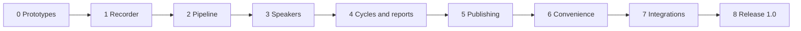

# Roadmap

Nine stages lead to version 1.0. Every stage ends with a tagged release, an updated README and changelog, and refreshed screenshots where the UI changed. Test methods, data sets and metric definitions are described in [TESTING.md](TESTING.md); prototypes and thresholds in [RISKS-AND-POC.md](RISKS-AND-POC.md).

Effort: **S** up to one week, **M** two to three weeks, **L** four weeks or more, for one developer.

| Stage | Name | Release | Effort |
|---|---|---|---|
| 0 | Prototypes and decision gate | v0.1.0 | M |
| 1 | Recorder | v0.2.0 | L |
| 2 | Processing pipeline | v0.3.0 | L |
| 3 | Speakers and voice profiles | v0.4.0 | M |
| 4 | Cycles and reports | v0.5.0 | L |
| 5 | Publishing | v0.6.0 | M |
| 6 | Convenience | v0.7.0 | L |
| 7 | Integrations | v0.8.0 | M |
| 8 | Stabilization and 1.0 | v1.0.0 | M |

---

## Stage 0. Prototypes and decision gate

**Goal.** Measure the risky components on the reference machine and fix the component choices before any product code is written.

**In scope.** Benchmark harness under `benchmarks/`, test data sets, measurement report, repository skeleton with CI.
**Not in scope.** Application code, UI.

**Depends on.** Nothing.

**Tasks**
1. Repository skeleton: license, README skeleton, CI (lint and hygiene checks), issue and PR templates.
2. Dependency and model license audit; fill the "to confirm" rows in ARCHITECTURE section 12; draft `NOTICE`.
3. Build the test data sets (TESTING section 3): scripted meetings in Polish, English and mixed, with ground truth.
4. P1 audio: per-process loopback for Discord, Teams and Chrome plus microphone, written as segments; minimum Windows version check.
5. P2 ASR: faster-whisper large-v3 against Parakeet-TDT-0.6B-v3; language `auto` against forced `pl`; with and without glossary prompt.
6. P3 diarization: pyannote community-1 on 2–4, 6–10 and 15+ speakers; with and without speaker count bounds.
7. P4 speaker recognition: embeddings from the diarization pipeline, enrollment from one meeting, recognition in another.
8. P5 LLM: two or three candidate models on the extraction set; JSON validity, quality, speed.
9. P6 vision: Qwen3-VL-8B on demo slides, charts and diagrams.
10. P7 Chrome: single-tab capture to a local WebSocket; two tabs with one click each.
11. P8 sidecar: environment creation with `uv` on a clean machine; size and time.
12. P9 end-to-end timing estimate for a 10-hour recording from the measured parts.
13. Write the measurement report and update the ADRs.

**Tests**
- *Unit:* benchmark metric code (WER, DER, extraction scoring) against hand-computed examples.
- *Integration:* each prototype runs from a single command and writes a JSON result file.
- *End-to-end:* none.
- *Measurements:* all thresholds in RISKS-AND-POC section 2.

**Decision gate.** For each of ASR, diarization, speaker recognition, LLM and vision: the primary choice passes its thresholds and is accepted, or the alternative is chosen, or the requirement is adjusted with the user's agreement. ADRs 0003–0006 move from *Proposed* to *Accepted* with the measured numbers.

**Definition of done**
- [ ] Every prototype has a result file and a paragraph in the measurement report
- [ ] ARCHITECTURE section 5 and 12 contain measured values and confirmed licenses
- [ ] ADRs 0002–0008 updated
- [ ] Default transcription language policy decided
- [ ] CI green
- [ ] Release v0.1.0 published

**Demo and visuals.** Benchmark result table in the README; no application screenshots yet.

**Docs and release.** README: project description, status, benchmark summary. CHANGELOG: first entry. Tag `v0.1.0`.

**Risks.** Results below thresholds for diarization or mixed-language ASR; gated model access; CUDA and driver mismatch.

**Stop and ask**
- before the gate decision, with the measurement report;
- if any threshold fails and a requirement would have to change.

---

## Stage 1. Recorder

**Goal.** A tray application that records reliably for ten hours with low overhead.

**In scope.** Tauri shell, tray widget, Record and Stop, source selection (microphone and applications), adding and removing sources during recording, segmented writing with journal, crash recovery, region screenshot hotkey, local meeting list, settings for folders and hotkeys.
**Not in scope.** Any processing, cycles, browser extension, meeting detection.

**Depends on.** Stage 0 (P1 results, audio format decision).

**Tasks**
1. Cargo workspace, Tauri shell, UI scaffold, IPC conventions, logging.
2. `store`: schema and migrations for meetings, tracks, segments.
3. `recorder`: microphone track, application loopback track, session clock.
4. Segment writer and session journal; recovery on start.
5. Source picker from audio sessions; add and remove during recording.
6. Region screenshot overlay and hotkey.
7. Tray widget and main window with the meeting list.
8. Demo mode with seeded data; screenshot script.

**Tests**
- *Unit:* journal encode, decode and replay; segment boundaries; offset arithmetic; source state machine.
- *Integration:* record generated tones through a virtual audio device and verify duration, continuity and track separation; add and remove a source mid-recording.
- *End-to-end:* start, record, screenshot, stop from the UI; recovery after the process is killed.
- *Measurements:* 10-hour soak; CPU, memory and dropped buffers; data lost after kill (thresholds in TESTING section 5).

**Definition of done**
- [ ] 10-hour soak passes
- [ ] Kill test loses at most one segment and the meeting is recoverable
- [ ] Microphone and two applications recorded as three separate tracks
- [ ] Source added mid-recording is aligned on the session clock
- [ ] Screenshots carry correct offsets
- [ ] CI green, including UI tests on the mock backend
- [ ] Release v0.2.0 published

**Demo and visuals.** GIF: start recording from the tray, add a source, take a region screenshot, stop. Screenshots: tray widget, source picker, meeting list.

**Docs and release.** README: features, quick start, requirements, first screenshots. CHANGELOG. Tag `v0.2.0`. Decision on making the repository public.

**Risks.** Applications that play audio from child processes; clock drift between devices; device changes during recording; overlay on multi-monitor and mixed-DPI setups.

**Stop and ask**
- UI direction after the first widget and main window mockups;
- repository visibility at the end of the stage.

---

## Stage 2. Processing pipeline

**Goal.** Turn a recording into a reviewed transcript with speakers and described screenshots, safely on a shared GPU.

**In scope.** Job queue, "now or later" prompt, manual Process, GPU guard, Python sidecar bootstrap, ASR, diarization, track merge, vision step, transcript viewer and editor with excluded passages, audio cleanup, backend settings.
**Not in scope.** Voice profiles, extraction, reports.

**Depends on.** Stages 0 and 1.

**Tasks**
1. `queue`: stage model, persistence, resume, supervisor.
2. GPU guard on NVML with configurable thresholds.
3. Sidecar bootstrap with `uv`; model download with progress; Hugging Face token handling.
4. `asr` step with language policy and glossary prompt.
5. `diarize` step and merge with word timestamps; microphone track as the user.
6. `vision` step with managed `llama-server`; transcript context window around each screenshot.
7. Transcript format and schema; viewer; editor with exclude and correct.
8. Audio cleanup rules and retention setting.
9. Queue screen with stage progress and reasons for waiting.

**Tests**
- *Unit:* stage state machine; GPU guard decisions on recorded NVML traces; merge of overlapping tracks; transcript schema.
- *Contract:* transcript and screenshot description schemas between Python and Rust.
- *Integration:* pipeline on the short reference recordings with real models; resume after killing the worker at each stage; behavior with the GPU occupied; behavior without network after models are cached.
- *End-to-end:* record a short scripted call, process, open the transcript, exclude a passage.
- *Measurements:* WER and DER on the reference set within Stage 0 results; processing time for a 2-hour recording; peak VRAM per stage.

**Definition of done**
- [ ] Meeting processed end to end from the UI
- [ ] Job resumes from the failed stage after a forced crash
- [ ] Processing does not start while the GPU is busy and starts once it is free
- [ ] Only one model process exists at any time
- [ ] Audio deleted only after all audio-dependent stages succeed
- [ ] Release v0.3.0 published

**Demo and visuals.** GIF: queue progressing through stages. Screenshots: queue, transcript with speakers, screenshot with description.

**Docs and release.** README: processing section, hardware requirements with measured numbers, model setup. CHANGELOG. Tag `v0.3.0`.

**Risks.** Sidecar environment size and CUDA compatibility; VRAM not released by a stuck process; long first-run downloads.

**Stop and ask**
- before deleting audio is enabled by default;
- if measured 2-hour processing time exceeds the threshold.

---

## Stage 3. Speakers and voice profiles

**Goal.** Naming speakers takes seconds, and known voices are recognized in later meetings.

**In scope.** Voice embeddings, sample clips, labeling screen, merging voices, voice profiles per cycle participant, automatic and suggested matches, profile management and deletion.
**Not in scope.** Full cycle model (a minimal local participant list is enough here and is replaced in Stage 4).

**Depends on.** Stage 2; P4 results.

**Tasks**
1. `speaker-id` step: embedding per detected voice.
2. `clips` step: selection of clear, non-overlapping samples.
3. Profile storage, update rule and match thresholds.
4. Labeling screen: voices, clip playback, assign, create, merge.
5. Propagation of names into the transcript.
6. Profile management: list, reset, delete.
7. Clip retention and cleanup.

**Tests**
- *Unit:* similarity and threshold logic; profile update; clip selection on synthetic segment lists.
- *Integration:* enroll from one reference recording and recognize in another; unknown voice stays unknown.
- *End-to-end:* label speakers once, process a second meeting, see names applied.
- *Measurements:* recognition accuracy and false-accept rate (TESTING section 5).

**Definition of done**
- [ ] Each detected voice is shown with playable clips
- [ ] Second meeting with the same voices needs no manual naming for matched speakers
- [ ] Unknown voices are never silently assigned to a known participant
- [ ] Profiles and clips can be deleted; nothing biometric leaves the machine
- [ ] Release v0.4.0 published

**Demo and visuals.** GIF: naming two voices from clips. Screenshot: labeling screen with a recognized and an unknown voice (synthetic voices).

**Docs and release.** README: speaker recognition and privacy notes. CHANGELOG. Tag `v0.4.0`.

**Risks.** Embedding quality on compressed conference audio; similar voices; short turns.

**Stop and ask**
- match thresholds, with examples of accepted and rejected matches.

---

## Stage 4. Cycles and reports

**Goal.** A meeting in a cycle produces an editable, trustworthy draft report.

**In scope.** Cycle repository layout, `cycle.yaml`, participants and glossary, clone and pull, cycle context, mandatory report mode, four report modes, template engine, natural-language instruction, extraction and reduce steps, quote verification, uncertainty markers, draft editor, output language, cloud backend per meeting.
**Not in scope.** Writing to GitHub or Discord, issue synchronization.

**Depends on.** Stages 2 and 3; P5 results.

**Tasks**
1. `cycle-store`: clone, pull, parse and validate cycle files; offline cache.
2. Cycle screens: create, edit participants, glossary, templates, targets.
3. Report mode selection gate before recording.
4. Extraction schema; `extract` and `reduce` steps; schema-constrained output with retry.
5. Quote verification and certainty fields.
6. Context builder from previous `meeting.json` files, open issues (read-only) and `topics.yaml`.
7. Template engine and the four modes; per-cycle instruction.
8. Draft editor: edit items, move between sections, show source quote, jump to transcript.
9. Output language setting and detection.
10. Backend settings: managed server, external server, cloud per meeting with confirmation dialog.

**Tests**
- *Unit:* template rendering; cycle file validation; windowing; quote matching; deduplication.
- *Contract:* extraction and `meeting.json` schemas; `cycle.yaml` schema.
- *Integration:* extraction on the labeled set against at least two backends; context carried from a previous meeting; cloud path against a mock server.
- *End-to-end:* cycle created, meeting recorded and processed, draft edited.
- *Measurements:* extraction metrics and quote validity (TESTING section 5); time for a 10-hour transcript.

**Definition of done**
- [x] All four report modes produce a draft
- [x] Every task, decision and topic shows a verifiable quote and timestamp
- [x] Inferred fields and unverified quotes are marked in the draft
- [x] Recording cannot start without a report mode
- [x] Report language follows the cycle setting, including `auto`
- [x] Cloud processing happens only after explicit per-meeting confirmation
- [x] Release v0.5.0 published

**Demo and visuals.** GIF: from transcript to draft, moving an item between sections. Screenshots: cycle settings, draft with source popover, report mode picker.

**Docs and release.** README: cycles, report modes, configuration reference. `docs/` page for the cycle repository format. CHANGELOG. Tag `v0.5.0`.

**Risks.** Extraction quality in Polish at this model size; wrong dates and assignees; long processing for long meetings.

**Stop and ask**
- built-in report sections and default template wording;
- default model after measurements.

---

## Stage 5. Publishing

**Goal.** The complete loop: meeting to repository, issues and Discord.

**In scope.** GitHub commit and push of the meeting folder, issues with assignee and due date, status proposals and approval, two-way status synchronization, Discord webhook with mentions and attachments, per-target templates and rules, secrets, outbox, public-repository warning.
**Not in scope.** Discord bot, Notion.

**Depends on.** Stage 4.

**Tasks**
1. `secrets` and token setup screens.
2. GitHub publisher: commit new files, push with rebase retry.
3. Issues: create, label, assign, due date (issue field or body), marker.
4. Status proposals in the draft; approval; write-back; reading issue state at pull.
5. `topics.yaml` updates and conflict rule.
6. Discord webhook publisher: short template, mentions with `allowed_mentions`, splitting, attachments.
7. Target rules: automatic or on approval.
8. Outbox and retry; offline behavior.

**Tests**
- *Unit:* message splitting at Discord limits; mention rendering; issue body marker; outbox state machine.
- *Integration:* GitHub and Discord against mock servers; a dedicated test repository and a test webhook for release checks.
- *End-to-end:* full loop on the demo cycle; issue closed on GitHub appears as done in the next briefing data.
- *Resilience:* publish without network, then recover; push rejected by a concurrent commit.

**Definition of done**
- [x] Report, transcript and screenshots committed under the cycle and date folder (tested against local bare remotes)
- [x] Tasks created as issues with assignee and due date (tested against a fake GitHub; the issue field "Target date" is unverified, the `Due:` line is the tested path)
- [x] Approved status changes written to GitHub; closed issues read back as done (tested against a fake GitHub)
- [x] Discord summary posted with role and user mentions and screenshots (tested against a fake webhook)
- [x] Each target follows its own rule and template (rules `auto`, `on-approval`, `off`; defaults proposed in [ADR 0019](decisions/0019-default-publish-rule-per-target.md))
- [x] No token appears in files, logs or the database (scan of the database, outbox rows, snapshots, both repositories and the log in the resilience tests)
- [x] Release check passed once against a real test repository and a real test webhook
- [ ] The organization issue field "Target date" verified on a real organization
- [x] Release v0.6.0 published

**Status.** Done and released as v0.6.0. Tasks 1 to 8 are covered by tests against fakes (TESTING section 14, [ADR 0018](decisions/0018-publishing.md)) and were run once against a real test repository and webhook, including a publish from the application window. Open: the "Target date" field on a real organization.

**Demo and visuals.** GIF: approve statuses and publish. Screenshots: publishing panel, example report rendered on GitHub, example Discord message (demo data). Done: taken on the mock backend with fake services (`docs/img`), not from real GitHub or Discord.

**Docs and release.** README: publishing setup guides and CHANGELOG are written; the tag `v0.6.0` is set.

**Risks.** Token scopes and rate limits; issue fields available only for organizations; attachment size limits.

**Stop and ask**
- before the first write to any real repository or channel;
- default rule per target.

---

## Stage 6. Convenience

**Goal.** After setup the user only presses Record and Stop.

**In scope.** Briefing screen, meeting detection with a prompt, Chrome extension with single-tab and guided tab-group capture, Meet detection, whole-browser fallback, pairing.
**Not in scope.** Other browsers.

**Depends on.** Stages 1 and 5; P7 results.

**Tasks**
1. Briefing: open tasks by person, open topics, "state as of" when offline.
2. Meeting detector from audio sessions and microphone use; prompt in the tray; per-application opt-out.
3. `bridge` server and pairing.
4. Extension: capture, replay, streaming, reconnection, Meet detection.
5. Tab groups: guided per-tab activation, tabs added later, status per tab.
6. Browser tracks in the source picker; whole-browser fallback.

**Tests**
- *Unit:* detector rules on recorded session traces; bridge protocol; briefing grouping.
- *Integration:* extension against the bridge in a scripted Chrome instance; reconnect after service worker restart.
- *End-to-end:* briefing, detection prompt, recording with a browser tab, processing.
- *Measurements:* continuity of a 30-minute tab capture; detection false prompts over a working day.

**Definition of done**
- [x] Briefing shows open tasks and topics from the repository (tested against local Git repositories and the mock backend: `crates/app/src/briefing.rs`, `ui/tests/briefing.spec.ts`)
- [ ] Starting a call in Discord, Teams or Meet raises one prompt, and idle applications raise none
- [ ] A captured tab stays audible and is recorded as its own track
- [x] A tab group can be captured with one action per tab (tested in scripted Chrome and unit tests: `extension/e2e/bridge.spec.ts`, `extension/test/groups.test.ts`)
- [x] Release v0.7.0 published

**Status.** Released as v0.7.0. Tasks 1 to 6 are implemented and covered by unit, mock and scripted-Chrome tests ([ADR 0020](decisions/0020-bridge-protocol-and-pairing.md), [ADR 0021](decisions/0021-extension-distribution.md), [ADR 0022](decisions/0022-meeting-detection.md)). Open: 30-minute real-tab capture (only the 2-minute synthetic run is recorded), 8-hour working-day detection trace, real Teams, Discord and Meet calls, Windows 11, and unpacked extension loading on Chrome 137 or newer.

**Demo and visuals.** GIF: detection prompt to recording; briefing screen. Screenshots: briefing, extension popup.

**Docs and release.** README: extension installation, briefing. CHANGELOG. Tag `v0.7.0` is set.

**Risks.** Chrome capture restrictions and stream release timing; false detections; extension distribution outside the Web Store.

**Stop and ask**
- extension distribution (unpacked from release or Chrome Web Store);
- detection sensitivity defaults.

---

## Stage 7. Integrations

**Goal.** Optional integrations that extend publishing.

**In scope.** Discord bot (member lookup by nickname, threads, editing published messages), Notion task export.
**Not in scope.** Voice recording through the bot; Todoist and Trello.

**Depends on.** Stage 5.

**Tasks**
1. Exporter interface shared by task targets.
2. Notion: token, database mapping, page per task, idempotent re-export.
3. Discord bot: token, member search and mapping to participants, thread per meeting, message edit after report correction.
4. Target configuration in the cycle.

**Tests**
- *Unit:* field mapping; idempotency keys.
- *Integration:* mock servers; test workspace and test server for release checks.
- *End-to-end:* tasks exported to Notion; report thread created and edited.

**Definition of done**
- [ ] Tasks appear in a Notion database without duplicates on re-export
- [ ] Participants can be mapped by searching server members
- [ ] Published Discord message can be updated after a correction
- [ ] Release v0.8.0 published

**Demo and visuals.** Screenshots: Notion mapping screen, Discord thread (demo data).

**Docs and release.** README: integration guides. CHANGELOG. Tag `v0.8.0`.

**Risks.** API changes; bot permissions and intents.

**Stop and ask**
- required bot permissions before documenting the setup.

---

## Stage 8. Stabilization and 1.0

**Goal.** A release other people can install and trust.

**In scope.** Installer, first-run setup, full regression in Polish and English, performance pass, complete documentation, `NOTICE`, security review, requirements traceability.
**Not in scope.** New features.

**Depends on.** All previous stages.

**Tasks**
1. Installer and first-run wizard (models, tokens, first cycle).
2. Regression suite over all reference sets; fix or document every failure.
3. 10-hour end-to-end run.
4. Requirements traceability check: every requirement mapped to a test or a demo step.
5. `NOTICE`, license review, dependency audit.
6. Documentation: user guide, troubleshooting, limitations, contributing.
7. Final screenshots and demo GIF; README polish.
8. Release notes and v1.0.0.

**Tests**
- *Regression:* all unit, contract, integration and end-to-end suites; pipeline on Polish, English and mixed sets against the Stage 0 baselines.
- *Installation:* clean Windows 10 and Windows 11 machines.
- *Resilience:* full set from TESTING section 6.
- *Measurements:* all thresholds re-measured and published.

**Definition of done**
- [ ] Installer works on a clean machine
- [ ] No metric regressed beyond tolerance against its baseline
- [ ] Every requirement is covered
- [ ] Known limitations documented
- [ ] `NOTICE` complete
- [ ] Release v1.0.0 published with installer

**Demo and visuals.** Hero GIF of the whole flow; full screenshot set.

**Docs and release.** Final README, CHANGELOG, GitHub release with installer and checksums.

**Risks.** Unsigned installer warnings; variability across GPUs and drivers.

**Stop and ask**
- go or no-go for 1.0 with the regression report.
